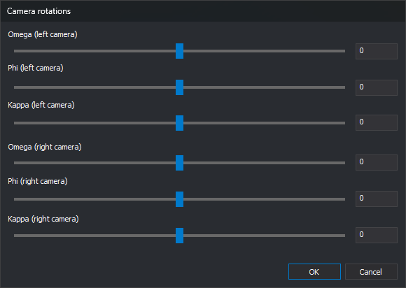

# CAMERA\_ROTATIONS
<!-- id: rotaciones-camaras -->
<!-- origen: 466cac3b5c0a18bd214c98029219b480819da1d2 -->

Rotates the photogrammetric window's images using each camera's _Omega_, _Phi_ and _Kappa_ angles.

## Parameters

None.

## Notes

Prompts for each image's rotation angles in **Camera rotations**.

The dialog has a slider and a field for each angle: _Omega_, _Phi_ and _Kappa_ for the left and right cameras. Angles range from -180 to 180 degrees. Sliders move in 0.1-degree steps; fields accept any value within the range.

Each change applies to the image immediately, whether you move a slider or enter a valid value. While a field does not contain a number between -180 and 180, for example while you type the minus sign of a negative value, the image remains unchanged. **OK** validates all six fields; if one is invalid, displays a message and leaves the dialog open.

**Cancel** restores the images' angles from when the command started.

For a monoscopic model, the right camera controls are disabled and the left camera controls rotate the single image.

If the sensor is projecting the images, CAMERA_ROTATIONS does not open the dialog. A balloon explains that you cannot rotate images manually while the sensor projects them: the sensor rotates them to the baseline direction to make parallax horizontal. The menu option is disabled while the sensor projects the images.

The conical camera sensor saves the left and right camera angles in the model file, preserving image rotations when you reload the model. It does not save a rotation matching an epipolar rectification, because it calculates that rotation itself.

## Command characteristics

| Command type | Interactiva |
| :--- | :--- |
| Repeats automatically | No |
| Menu option | Photogrammetric window/Images transformation/Camera rotations... |
| Toolbar | _This command has no associated toolbar button_ |
| Extension | Digi3D.CommonCommands.dll |
| Implementation | Native |
| Internal name | {C96276F0-D517-4AAB-A662-4A7FEC6BCFA8} |
| Related variables | No related variables |
| Related commands | No related commands |
