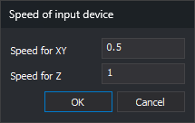

# SPEED
<!-- id: velocidad -->
<!-- origen: bebe92f1ec4a0a96a3597cad55ab46cfb8382de2 -->

Changes the plotter's speed.

## Parameters

| Parameter | Real number |
| :--- | :--- |
| X and Y speed | No |
| Z speed | No |

## Notes

The photogrammetric window has one speed for the XY plane and another for the Z axis.

Command format:

**SPEED=\[xy\] \[z\]**

If you omit the Z speed, it is set to the XY speed.

With no parameters, prompts for both speeds in **Speed of input device**, initially showing the current speeds.

* **Speed for XY**: movement speed in the XY plane.
* **Speed for Z**: movement speed along the Z axis.

**OK** displays a message and leaves the dialog open if either field is nonnumeric. **Cancel** leaves speeds unchanged.

Assigned speeds are saved in the user configuration \(registry values `VelocidadXY` and `VelocidadZ`\) and shown in the photogrammetric window's status bar.

The **Restart** menu option runs `SPEED=1.0 1.0`.

### Examples:

`SPEED=5.75`

Sets the factors multiplying movement in the XY plane and along Z to 5.75.

`SPEED=5.75 4.22`

Sets the factor multiplying movement in the XY plane to 5.75 and the factor for Z to 4.22.

## Command characteristics

| Command type | Interactive command without parameters; immediate command with parameters |
| :--- | :--- |
| Repeats automatically | No |
| Menu option | Photogrammetric window/Speed/Assign speed... Photogrammetric window/Speed/Restart |
| Toolbar | _This command has no associated toolbar button_ |
| Extension | Digi3D.CommonCommands.dll |
| Implementation | Native |
| Related variables | No related variables |
| Related commands | [SCALE\_SPEED](/digi3d-ai/referencia/ventana-fotogrametrica/ordenes/e/escalar-velocidad.md) [SPEED\_INCR\_XY](/digi3d-ai/referencia/ventana-fotogrametrica/ordenes/v/velocidad-mas-xy.md) [SPEED\_INCR\_Z](/digi3d-ai/referencia/ventana-fotogrametrica/ordenes/v/velocidad-mas-z.md) [SPEED\_DECR\_XY](/digi3d-ai/referencia/ventana-fotogrametrica/ordenes/v/velocidad-menos-xy.md) [SPEED\_DECR\_Z](/digi3d-ai/referencia/ventana-fotogrametrica/ordenes/v/velocidad-menos-z.md) |
| Internal name | {3BE1084C-E1BC-4b4f-AD45-611112560D6B} |
