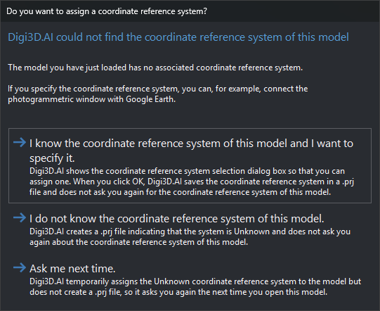
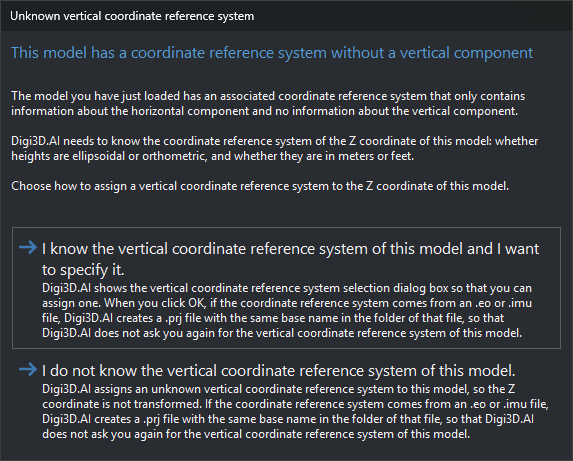

# Model without a coordinate reference system
<!-- id: modelo-sin-sistema-de-referencia -->
<!-- origen: 023fdd02489c28707b89d66369c85253cf2ed68b -->

When loading a [Conical](README.md) sensor model, the extension reading the aerial triangulation file obtains the model's coordinate reference system from it. If the file specifies no system, or a system without a vertical component, most extensions display one of the dialogs on this page.

[Access](extensiones/access.md), [AeroOffice](extensiones/aerooffice.md), [DVP](extensiones/dvp.md), [EspaKernel](extensiones/espakernel.md), [IMU](extensiones/imu.md), [Intergraph](extensiones/intergraph.md), [LPS](extensiones/lps.md), [PatB](extensiones/patb.md), [Pix4D](extensiones/pix4d.md) and [Summit](extensiones/summit.md) display the horizontal system dialog. [PhotoScan](extensiones/photoscan.md), which reads Metashape projects, displays it only when the project specifies no system or a local system. [Inpho](extensiones/inpho.md) and [Digi3D](extensiones/digi3d.md) do not display it: if they cannot obtain the system from the file, they assign an unknown system. [ContextCapture](extensiones/contextcapture.md) does not load the model if the file specifies no system.

For example, [IMU](extensiones/imu.md) reads an `.eo` file's system in this order: the `.prj` file with the same name (`Bronchales.prj` for `Bronchales.eo`), the `.eo` file's EPSG code and, if neither is available, the horizontal system dialog.

## Horizontal coordinate reference system

**Would you like to assign one?** (“We have not located the coordinate reference system of this project”) offers three options:

* **I know the coordinate reference system of this project and I want to indicate what is.**: opens coordinate reference system selection. Accepting creates a `.prj` with the selected system beside the aerial triangulation file, with the same name (for [DVP](extensiones/dvp.md), beside the left image). Cancelling selection behaves like the next option.
* **I don't know the coordinate reference system of this project.**: creates the `.prj` with an unknown compound system named “Unknown horizontal coordinate system + Unknown vertical coordinate system”.
* **I would like to ask me next time.**: assigns the same unknown system without creating a `.prj`. The dialog reappears the next time you load the model.

Extensions read this `.prj` before asking, so the dialog no longer appears for that aerial triangulation file. Edit or delete the `.prj` to change the system. If the `.prj` cannot be created (for example, in a read-only folder), Digi3D.AI shows no message, loads the model with the selected system and asks again on the next load.

With an unknown system, Digi3D.AI cannot transform model coordinates to other systems, for example to connect the photogrammetric window with Google Earth.

## Vertical coordinate reference system

If the aerial triangulation file's system has only a horizontal component and [Ask for sensor's vertical system](../../../cuadros-de-dialogo/configuracion/sistema-de-referencia-de-coordenadas/solicitar-sistema-vertical-para-sensores.md) is **Yes**, **Unknown vertical coordinate system** (“This model has coordinate referente system, but without vertical component”) offers two options:

* **I know the Vertical coordinate reference system of this model and I want to indicate it**: opens vertical coordinate reference system selection. The model uses the file's horizontal system with the selected vertical system. Cancelling selection returns to **Unknown vertical coordinate system**.
* **I don't know the vertical coordinate reference system of this model.**: combines the file's horizontal system with an unknown vertical system. Digi3D.AI does not transform Z.

If the system comes from the EPSG code of an [IMU](extensiones/imu.md) `.eo` or `.imu` file, either choice creates a `.prj` beside that file with the same name (`Bronchales.prj` for `Bronchales.eo`). It contains the model's compound system: the file's horizontal system and the selected or unknown vertical system. The extension reads `.prj` before the EPSG code, so the dialog no longer appears for that file. Delete `.prj` to show it again. The `.eo` file is unchanged. If `.prj` cannot be created (for example, in a read-only folder), the model still loads and the dialog reappears next time.

For other formats, such as Metashape and Inpho projects, the selection is not saved and the dialog appears on every load. With **Ask for sensor's vertical system** set to **No**, the dialog does not appear, the vertical system is unknown and no file is created.
