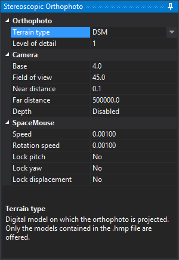

# Stereoscopic Orthophoto
<!-- id: ortofoto-estereoscopica -->
<!-- origen: 3ada04a2ab3f19732fbc3585f98c14f267c1716c -->

The Stereoscopic Orthophoto sensor displays a single orthophoto in stereo, projected onto a digital terrain model (DTM) or digital surface model (DSM). Two virtual cameras, separated by the base specified in the panel, generate the stereo pair.

The sensor reads a `.hmp` (pyramidal height map) file containing the orthophoto and at least one digital model. Create it with the [Stereo Orthophoto File Generator](../../generador-de-archivos-de-ortofoto-estereoscopica.md). Configure general options under [Stereoscopic Orthophoto](../../cuadros-de-dialogo/configuracion/ortofoto-estereoscopica/README.md) in **Configuration**.

## Stereoscopic Orthophoto panel

Loading the sensor adds the **Stereoscopic Orthophoto** panel on the right. It cannot be closed. Its lower area describes the selected property. Changes apply immediately.

### Orthophoto

| Property | Description |
|---|---|
| **Terrain type** | Digital model used to project the orthophoto: **DTM** or **DSM**. Only models present in `.hmp` are offered. If both exist, DTM is initially selected |
| **Level of detail** | Divisor for tile mesh vertex count: 1, 2, 4, 8, 16, or 32. At 1, all digital model points are used; higher values produce simpler meshes. Initially 1 |

### Camera

| Property | Description |
|---|---|
| **Base** | Distance between virtual cameras, in orthophoto pixels. A larger base increases perceived relief |
| **Field of view** | Vertical camera field of view, in sexagesimal degrees |
| **Near distance** | Near camera plane distance. Closer content is not drawn |
| **Far distance** | Far camera plane distance. More distant content is not drawn |
| **Depth** | **Enabled**: terrain hides vector geometries behind it. **Disabled**: geometries are always drawn over terrain |

### SpaceMouse

These properties control camera operation with a 3Dconnexion SpaceMouse.

| Property | Description |
|---|---|
| **Speed** | Multiplier for SpaceMouse translations |
| **Rotation speed** | Multiplier for SpaceMouse rotations |
| **Lock pitch** | Ignore pitch rotations when enabled |
| **Lock yaw** | Ignore yaw rotations when enabled |
| **Lock displacement** | Ignore translations on all three axes when enabled |

Roll is always ignored, keeping the camera horizon fixed.

Digi3D.AI remembers **Base**, **Field of view**, **Near distance**, **Far distance**, **Depth**, **Speed**, and **Rotation speed** between sessions. **Terrain type**, **Level of detail**, and the three lock checkboxes reset whenever the sensor loads.
