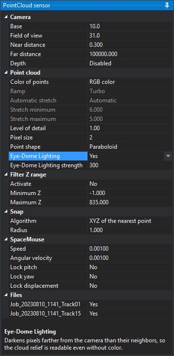

# PointCloud
<!-- id: point-cloud -->
<!-- origen: 9d2360d9ade0a6e7ef09b7b48f8c1627d7436296 -->

The PointCloud sensor displays point clouds in stereo and supports measurements on them. Two virtual cameras separated by the panel base generate the stereo pair.

A project can combine clouds from two sources:

* **Local files**: `.las`, `.laz`, `.pts`, `.e57`, and `.ptx` files in the project working directory.
* **Remote clouds**: URLs in the `.d3d` `<clouds>` node. Each points to a level of detail in an Azure blob container or a `.json` catalog listing several. Specify it when creating the project in **Point cloud URL**.

## Creating the level of detail

Digi3D.AI does not draw local files directly. Opening a project creates a level of detail (`.index` and `.index.points` files) in the [level of detail directory](../../cuadros-de-dialogo/configuracion/creacion-de-archivos-de-nivel-de-detalle-de-pointcloud/directorio-de-nivel-de-detalle.md). First opening creates it; subsequent openings reuse it while the source modification timestamp is unchanged. Remote clouds already provide levels of detail and skip this process.

**Creating level of detail** shows current-phase and total progress, with the phase in its title. **Cancel** or **Esc** stops creation: the title becomes **Cancelling...**, partially written files for the current cloud are removed, "The creation of the level of detail has been cancelled. The point cloud has not been opened." appears, and the project does not open. Completed cloud levels and the `.prj` for the chosen reference system are retained. Canceling after all clouds are processed still opens the project. Next opening recreates the canceled cloud level from the start.

Configure creation under [PointCloud level of detail file creation](../../cuadros-de-dialogo/configuracion/creacion-de-archivos-de-nivel-de-detalle-de-pointcloud/README.md) in **Configuration**.

## Reference system

For the first local file, Digi3D.AI looks for its reference system in this order: the level of detail `.prj`, the `.las` GeoTIFF header, then a selection dialog. A selected system is saved in the level of detail `.prj`.

Projects with only remote clouds use the `.prj` published beside the first cloud. Without it, the first opening requests a system and saves it in `%TEMP%\LOP\Azure\<identificador de la nube>\sistema-referencia.prj`. The cloud identifier uses the URL without the portion after `?`, which contains the shared access signature (SAS): the file contains no token, and renewed signatures reuse it. An invalid saved reference system causes another selection and overwrites the file.

## PointCloud sensor panel

Loading the sensor adds **PointCloud sensor** on the right. Its lower area describes the selected property. Changes apply immediately.

### Camera

| Property | Description |
|---|---|
| **Base** | Virtual camera separation, in parts per thousand of the camera plane-to-cursor distance. A larger base increases perceived relief |
| **Field of view** | Vertical camera field of view in sexagesimal degrees |
| **Near distance** | Near camera plane distance. Closer content is not drawn |
| **Far distance** | Far camera plane distance. More distant content is not drawn |
| **Depth** | **Enabled**: the cloud hides vector geometries behind it. **Disabled**: geometries are always drawn over the cloud |

### Point cloud

| Property | Description |
|---|---|
| **Color of points** | Color source: **RGB color**, **Classification**, **Intensity**, **Elevation**, **RGB × Intensity**, **By cloud** (a distinct color for each project cloud), or **Return number** |
| **Ramp** | Color ramp for **Intensity**, **Elevation**, and **Return number**: **Grayscale**, **Rainbow**, **Viridis**, **Turbo**, or **Blue-red**. Read-only with other color sources |
| **Automatic stretch** | Value range spread along the ramp; for **RGB × Intensity**, the intensity range multiplying color. **Automatic** uses the range between the second and 98th percentiles of each cloud; **Elevation** uses a single range spanning all visible clouds. **Manual** uses **Stretch minimum** to **Stretch maximum**. Editable only for **Intensity**, **Elevation**, and **RGB × Intensity** |
| **Stretch minimum** | Start of the manual range, in source units: reference system Z units for elevation, unscaled values for intensity. Editable only with **Manual** stretch. Switching to **Manual**, or changing **Color of points** while manual, fills both limits: minimum and maximum cloud Z for elevation, or second and 98th cloud percentiles for intensity |
| **Stretch maximum** | End of the manual range, in the same units as **Stretch minimum** |
| **Level of detail** | Threshold for replacing a tile with denser child tiles. Subdivision continues while projected point spacing exceeds this value in screen pixels: lower values draw more points. It also caps point diameter at **Pixel size** × **Level of detail** pixels |
| **Pixel size** | Multiplier for screen point diameter, proportional to projected tile point spacing, with a minimum of 1 pixel |
| **Point shape** | **Square**: fill a pixel square. **Round**: discard corner pixels. **Paraboloid**: also round, increasing pixel depth toward the edge so overlapping points form a continuous surface |
| **Eye-Dome Lighting** | Screen depth-difference shading (EDL, *Eye-Dome Lighting*): darken pixels according to how much farther they are from the camera than neighbors. Shows cloud relief without point colors and works with every **Color of points** value |
| **Eye-Dome Lighting strength** | EDL darkening intensity. Larger values increase relief contrast. Editable only when **Eye-Dome Lighting** is **Yes** |

### Filter Z range

| Property | Description |
|---|---|
| **Activate** | **Yes** draws only points between **Minimum Z** and **Maximum Z**. Also applies to **Z of highest point** and **Z of lowest point** snap algorithms |
| **Minimum Z** | Lower limit in reference system units |
| **Maximum Z** | Upper limit in reference system units |

### Snap

Snapping moves the cursor to cloud points less than **Radius** from the ray starting at the camera, passing through the cursor, and ending at **Far distance**. It works only with toolbar **Snap** enabled. It considers points in tiles already in memory, including clouds hidden under **Files**. With multiple clouds, apply the algorithm to each and choose the resulting point nearest the camera.

| Property | Description |
|---|---|
| **Algorithm** | **Z of highest point** retains cursor X and Y and takes the highest point Z. **Z of lowest point** retains X and Y and takes the lowest point Z. **XYZ of the nearest point** moves to the point nearest the ray |
| **Radius** | Maximum point-to-ray distance in reference system units |

### SpaceMouse

These properties control camera operation with a 3Dconnexion SpaceMouse.

| Property | Description |
|---|---|
| **Speed** | Multiplier for SpaceMouse translations |
| **Angular velocity** | Multiplier for SpaceMouse rotations |
| **Lock pitch** | Ignore pitch rotations when enabled |
| **Lock yaw** | Ignore yaw rotations when enabled |
| **Lock displacement** | Ignore translations on all three axes when enabled |

Roll is always ignored, keeping the camera horizon fixed.

### Files

Each loaded cloud has a checkbox showing its filename without extension, or the last URL segment without SAS for remote clouds. **Yes** draws the cloud; **No** hides it.

### Remembered values

Digi3D.AI saves properties to the Windows registry immediately when changed, except **Lock pitch**, **Lock yaw**, **Lock displacement**, and **Files** checkboxes, which reset on sensor loading. Saving the project also writes **Camera**, **Point cloud**, **Filter Z range**, and **Snap** properties to `.d3d`. On opening, `.d3d` values take precedence over the registry.
