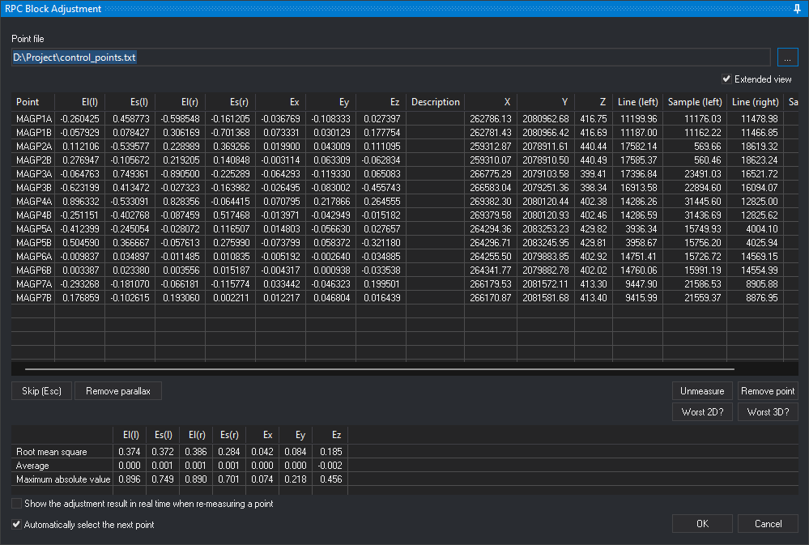

# RPC Block Adjustment
<!-- id: ajuste-en-bloque-de-rpcs -->
<!-- origen: 324841dfbcfef006cb5a395dbb273a9e450016a7 -->



**RPC Block Adjustment** calculates a correction to both model images' RPC coefficients from stereoscopically measured control points (RPCBA, *RPC Block Adjustment*). Compensates image coordinate shifts and affine deformations.

Select **Photogrammetric window/RPC Block Adjustment**. Requires:

* The active stereoscopic [RPC Satellite](README.md) sensor.
* No other RPC block adjustment command running.
* Different left and right model images.

Otherwise displays a message and ends.

## On startup

1. Clears both images' affine RPC corrections. Measurements use uncorrected RPCs even with a saved adjustment.
2. Loads the last point file. If missing, requests one; cancellation ends the command.
3. Loads previous measurements from `<directorio de trabajo>\<nombre del modelo>.rpcba` or, if that does not exist, from `<directorio de trabajo>\<imagen izquierda>-<imagen derecha>.rpcba` (image names without extension), if present.

## Point file

Text file with one point per line: space-separated name, X, Y, Z and optional description. Ignores lines with fewer than four fields. Names are case-sensitive: P1 and p1 differ. Loads only points projected inside both images.

**Point file** shows the loaded path. **...** selects another `.xyz`, `.pnt`, `.ctl` or `.txt`. Replaces the list while retaining same-name measurements. Measurements absent from the new file remain saved in `.rpcba` but do not participate in adjustment. An unreadable file leaves the previous one loaded.

## Point list

One row per point file entry:

| Column | Contents |
| --- | --- |
| **Point** | Point name. |
| **El(l)**, **Es(l)** | Left-image row and column residuals in pixels: adjusted computed position minus measured position. |
| **El(r)**, **Es(r)** | Right-image row and column residuals in pixels. |
| **Ex**, **Ey**, **Ez** | Adjusted position minus point file coordinates, in sensor CRS units. |
| **Description** | Point file description. |

Residual columns remain empty until measurement and adjustment calculation. In each of the **Ex**, **Ey** and **Ez** columns, Digi3D.AI shows in red the cells whose absolute value, rounded to the six decimals the cell shows, is the largest in the column (all tied cells), unless that value is 0.

**Extended view** adds **X**, **Y**, **Z** (point file coordinates) and measured **Line (left)**, **Sample (left)**, **Line (right)** and **Sample (right)**. The setting persists between sessions.

## Measuring a point

1. Click a listed point. Moves the cursor to its coordinates and displays **Digitize point *name* stereoscopically** in the status bar.
2. Position stereoscopically and press the recording button. Saves row and column in both images and recalculates adjustment.

Calculation starts at [Number of points to calculate](../../../cuadros-de-dialogo/configuracion/parametros-del-ajuste-rpcba/numero-de-puntos-para-calcular.md). Only measured points present in the point file count and participate. Failure to converge within 100 iterations leaves RPCs unchanged and clears residual columns and [residual statistics](#residual-statistics). Configure accuracies in [RPCBA adjustment parameters](../../../cuadros-de-dialogo/configuracion/parametros-del-ajuste-rpcba/README.md).

## Buttons

| Button | Action |
| --- | --- |
| **Skip (Esc)** | Deselects the point being measured. During **Remove parallax**, cancels that operation. Equivalent to **Esc**. |
| **Remove parallax** | Shifts right-image RPCs to remove parallax at one point. Digitize first in the left image, which locks there, then the same point in the right. Adds row and column differences between inputs to the right correction. The status bar identifies the required image. Persists until recalculation caused by measuring, unmeasuring, removing or skipping a point, or changing point files. **OK** before recalculation saves the correction with the adjustment. |
| **Unmeasure** | Clears selected point measurements and recalculates. Leaves the point listed. |
| **Remove point** | Removes selected point and measurements without changing the point file. Deselects it if currently being measured. |
| **Worst 2D?** | Selects the point with the largest absolute row or column residual in either image and moves there for remeasurement. |
| **Worst 3D?** | Selects the greatest X, Y or Z difference between adjusted position and point file coordinates, moving there. |

## Residual statistics

Below the buttons, three statistics per residual column (**El(l)**, **Es(l)**, **El(r)**, **Es(r)**, **Ex**, **Ey**, **Ez**) are calculated from measured points:

| Row | Contents |
| --- | --- |
| **Root mean square** | Square root of the mean squared residuals. |
| **Average** | Signed sum divided by residual count. |
| **Maximum absolute value** | Largest absolute residual. |

Uncomputable residuals appear as nonnumeric values and are excluded from that column's statistics. **El(l)**, **Es(l)**, **El(r)** and **Es(r)** use pixels; **Ex**, **Ey** and **Ez** use sensor CRS units. Cells remain empty without a calculated adjustment.

## Options

* **Show the adjustment result in real time when re-measuring a point**: with a selected point, cursor movement recalculates as though measured at that position, updating the list and statistics. Saves measurement only on recording input. Does not recalculate during **Remove parallax** or afterwards while that correction remains.
* **Automatically select the next point**: after measurement, selects the first unmeasured point by name and moves there.

## OK and Cancel

**OK** saves a calculated adjustment:

* Corrected image RPCs to `<directorio de trabajo>\<nombre de la imagen>.digi3d_rpcba`. Loaded by RPC Satellite when opening the model.
* Measurements to `<directorio de trabajo>\<nombre del modelo>.rpcba`. The model name is the name of the `.d3d` file without extension.
* Report to `<directorio de trabajo>\<nombre del modelo>.rpcba.txt`. See [Adjustment report](#adjustment-report). Results shows its path.

After saving with **OK**, displays measured control points. See [Measured control points in the photogrammetric window](#measured-control-points-in-the-photogrammetric-window).

Without a calculated adjustment, **OK** closes without saving.

**Cancel**, or any other termination without accepting an adjustment, restores both images' initial RPCs. Measurements are not saved.

## Adjustment report

`<nombre del modelo>.rpcba.txt` is UTF-8 text in the interface language, containing:

1. Header titled “Digi3D.AI - Block adjustment report for rational polynomial coefficients (RPC)”, generation date and time, model and image names, point file path, ground and RPC reference systems, adjustment point count and column descriptions.
2. Per-image tables:
   * **Point**, **X**, **Y**, **Z**: point file name and coordinates.
   * **Ef**, **Ec**: adjusted computed row and column minus measured values, in pixels. Correspond to pane **El(l)** and **Es(l)** or **El(r)** and **Es(r)**.
   * **DX**, **DY**: X and Y of the intersection between the measured image ray and the constant-height surface at the point elevation, minus point file X and Y.

   Image RPC correction coefficients (`IOCOEF_LINE`, `IOCOEF_SAMPLE`) follow each table.
3. Stereo model table with **DX**, **DY**, **DZ**: adjusted coordinates minus point file coordinates, matching pane **Ex**, **Ey**, **Ez**.

Each table is followed by root mean square, average and maximum absolute residuals. Uncomputable image **DX** or **DY** cells are blank and excluded from statistics. X, Y, Z, DX, DY and DZ use ground CRS units.

Report for a two-image Pléiades Neo model adjusted with 14 control points in WGS 84 / UTM zone 19N:

```text
Digi3D.AI - Informe del ajuste en bloque de coeficientes polinómicos racionales (RPC)

Fecha: 2026-10-28 10:26:26
Modelo: IMG_PNEO4_202308011531456_PMS_SEN_PWOI_000126295_1_1_F_1_RGBN_R1C1-IMG_PNEO4_202308011531166_PMS_SEN_PWOI_000126295_2_1_F_1_RGBN_R1C1
Imagen izquierda: IMG_PNEO4_202308011531456_PMS_SEN_PWOI_000126295_1_1_F_1_RGBN_R1C1
Imagen derecha: IMG_PNEO4_202308011531166_PMS_SEN_PWOI_000126295_2_1_F_1_RGBN_R1C1
Archivo de puntos: D:\Proyecto\puntos_de_apoyo.txt
Sistema de referencia de coordenadas del terreno: WGS 84 / UTM zone 19N + Sistema de coordenadas vertical local
Sistema de referencia de coordenadas de los RPC: WGS 84
Puntos en el ajuste: 14

Ef, Ec: fila y columna calculadas con el ajuste menos fila y columna medidas, en píxeles. DX y DY de cada imagen: coordenadas X e Y, respectivamente, del punto donde el rayo correspondiente a la fila y la columna medidas en esa imagen interseca la superficie de altura constante situada a la cota del punto, menos las coordenadas X e Y del archivo de puntos. DX, DY, DZ del modelo estereoscópico: coordenadas ajustadas menos las coordenadas del archivo de puntos. X, Y, Z, DX, DY y DZ están en unidades del sistema de referencia de coordenadas del terreno.

Imagen izquierda: IMG_PNEO4_202308011531456_PMS_SEN_PWOI_000126295_1_1_F_1_RGBN_R1C1
------------------------------------------------------------------------------------------------------
Punto                        X               Y           Z         Ef         Ec         DX         DY
------------------------------------------------------------------------------------------------------
MAGP1A              262786.128     2080962.680     416.748     -0.260      0.459     -0.179     -0.189
MAGP1B              262781.429     2080966.421     416.695     -0.058      0.078      0.101      0.031
MAGP2A              259312.867     2078911.615     440.435      0.112     -0.540      0.228      0.093
MAGP2B              259310.070     2078910.502     440.494      0.277     -0.106      0.014      0.143
MAGP3A              266775.294     2079103.577     399.411     -0.065      0.749     -0.289     -0.137
MAGP3B              266583.041     2079251.360     398.342     -0.623      0.413     -0.303     -0.329
MAGP4A              269382.297     2080120.444     402.375      0.896     -0.533      0.330      0.530
MAGP4B              269379.576     2080120.930     402.459     -0.251     -0.403      0.112     -0.121
MAGP5A              264294.360     2083253.227     429.823     -0.412     -0.245      0.101     -0.181
MAGP5B              264296.714     2083245.947     429.815      0.505      0.367     -0.288      0.178
MAGP6A              264255.503     2079883.850     402.921     -0.010      0.035     -0.027     -0.010
MAGP6B              264341.770     2079882.778     402.017      0.003      0.023     -0.022     -0.002
MAGP7A              266179.534     2081572.112     413.299     -0.293     -0.181      0.152     -0.115
MAGP7B              266170.871     2081581.675     413.396      0.177     -0.103      0.051      0.104
------------------------------------------------------------------------------------------------------
                                    Error medio cuadrático      0.374      0.372      0.191      0.203
                                                     Media      0.000      0.001     -0.001      0.000
                                     Máximo valor absoluto      0.896      0.749      0.330      0.530

Corrección de los RPC de la imagen:
IOCOEF_LINE: 4.400929 0.000173 0.000103
IOCOEF_SAMPLE: -24.213050 -0.000201 -0.000093

Imagen derecha: IMG_PNEO4_202308011531166_PMS_SEN_PWOI_000126295_2_1_F_1_RGBN_R1C1
------------------------------------------------------------------------------------------------------
Punto                        X               Y           Z         Ef         Ec         DX         DY
------------------------------------------------------------------------------------------------------
MAGP1A              262786.128     2080962.680     416.748     -0.599     -0.161      0.018     -0.308
MAGP1B              262781.429     2080966.421     416.695      0.306     -0.701      0.337      0.071
MAGP2A              259312.867     2078911.615     440.435      0.229      0.369     -0.073      0.097
MAGP2B              259310.070     2078910.502     440.494      0.219      0.141     -0.060      0.151
MAGP3A              266775.294     2079103.577     399.411     -0.890     -0.225      0.019     -0.423
MAGP3B              266583.041     2079251.360     398.342     -0.027     -0.164     -0.076      0.014
MAGP4A              269382.297     2080120.444     402.375      0.828     -0.064      0.155      0.418
MAGP4B              269379.576     2080120.930     402.459     -0.087      0.517     -0.184     -0.057
MAGP5A              264294.360     2083253.227     429.823     -0.028      0.117     -0.016     -0.070
MAGP5B              264296.714     2083245.947     429.815     -0.058      0.276     -0.232      0.122
MAGP6A              264255.503     2079883.850     402.921     -0.011      0.011     -0.016      0.002
MAGP6B              264341.770     2079882.778     402.017      0.004      0.015     -0.017      0.010
MAGP7A              266179.534     2081572.112     413.299     -0.066     -0.116      0.115     -0.117
MAGP7B              266170.871     2081581.675     413.396      0.193      0.002      0.016      0.104
------------------------------------------------------------------------------------------------------
                                    Error medio cuadrático      0.386      0.284      0.135      0.195
                                                     Media      0.001      0.001     -0.001      0.001
                                     Máximo valor absoluto      0.890      0.701      0.337      0.423

Corrección de los RPC de la imagen:
IOCOEF_LINE: -19.434949 0.000004 0.000097
IOCOEF_SAMPLE: -26.033315 0.000399 -0.000058

Modelo estereoscópico
-------------------------------------------------------------------------------------------
Punto                        X               Y           Z         DX         DY         DZ
-------------------------------------------------------------------------------------------
MAGP1A              262786.128     2080962.680     416.748     -0.037     -0.108      0.027
MAGP1B              262781.429     2080966.421     416.695      0.073      0.030      0.178
MAGP2A              259312.867     2078911.615     440.435      0.020      0.043      0.111
MAGP2B              259310.070     2078910.502     440.494     -0.003      0.063     -0.063
MAGP3A              266775.294     2079103.577     399.411     -0.064     -0.119      0.065
MAGP3B              266583.041     2079251.360     398.342     -0.026     -0.083     -0.456
MAGP4A              269382.297     2080120.444     402.375      0.071      0.218      0.265
MAGP4B              269379.576     2080120.930     402.459     -0.014     -0.043     -0.015
MAGP5A              264294.360     2083253.227     429.823      0.015     -0.057      0.028
MAGP5B              264296.714     2083245.947     429.815     -0.074      0.058     -0.321
MAGP6A              264255.503     2079883.850     402.921     -0.005     -0.003     -0.035
MAGP6B              264341.770     2079882.778     402.017     -0.004      0.001     -0.034
MAGP7A              266179.534     2081572.112     413.299      0.033     -0.046      0.200
MAGP7B              266170.871     2081581.675     413.396      0.012      0.047      0.016
-------------------------------------------------------------------------------------------
                                    Error medio cuadrático      0.042      0.084      0.185
                                                     Media      0.000      0.000     -0.002
                                     Máximo valor absoluto      0.074      0.218      0.456
```

## Measured control points in the photogrammetric window

With `<directorio de trabajo>\<nombre del modelo>.rpcba` present or, if that does not exist, `<directorio de trabajo>\<imagen izquierda>-<imagen derecha>.rpcba` (image names without extension), each image displays measured points as circles at measured positions with point names. Reads the file on model opening and **OK** in this pane. Without either file, no measured control points appear, including after switching from another model in the same project.

* Circles use the conical camera sensor's control point color and size, adjustable in **Configuration**.
* The measured point checkbox in image properties shows or hides circles and names.

## Projects with multiple pairs

Adjusts only the loaded pair's two images. For a [project with multiple pairs](README.md#projects-with-multiple-pairs), load, measure and accept **OK** for each pair separately.

Corrections are saved per image in `<directorio de trabajo>\<nombre de la imagen>.digi3d_rpcba`. Pairs sharing an image and work directory share that correction: accepting one replaces it, and the other uses the new correction when reloaded.
