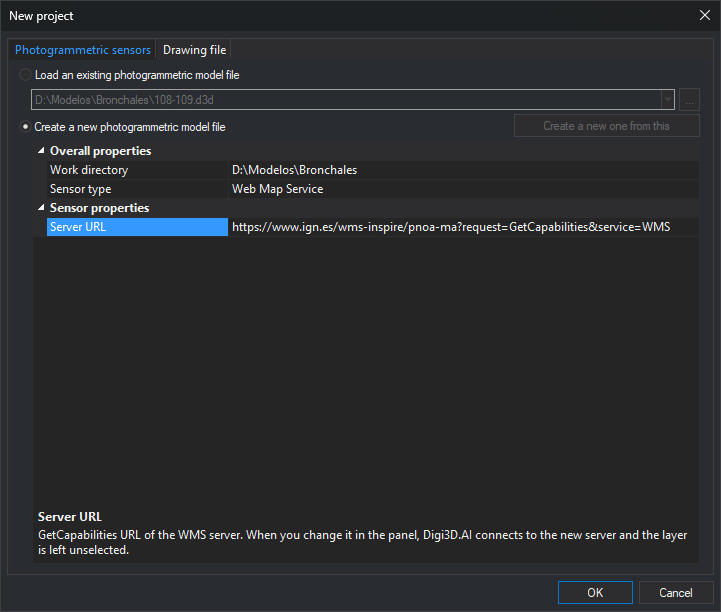
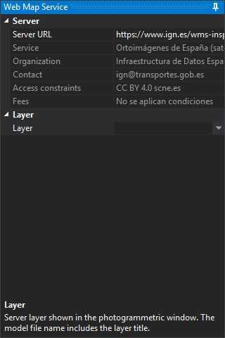
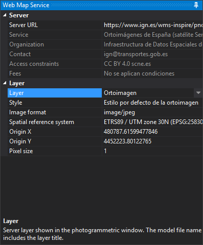
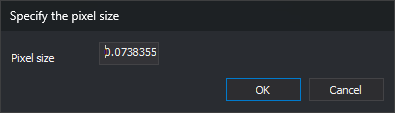

# Web Map Service
<!-- id: sensor-wms -->
<!-- origen: b4a48b2d7b2631ab3a0918cb1855a2a3a0a0fe08 -->

The Web Map Service sensor displays a WMS (*Web Map Service*) server layer in the photogrammetric window, such as the PNOA orthophoto. The model has one image and no stereoscopy. Digi3D.AI requests tiles for the visible area as you move through it.

For WMS layers in the drawing window, see [Connecting to a WMS server](/digi3d-ai/procedimientos/conectar-servidor-wms.md).

## Creating the model

On [Photogrammetric sensors](../../cuadros-de-dialogo/nuevo-proyecto/sensores-fotogrametricos.md) in **New project**, choose **Create a new photogrammetric model file** and **Web Map Service** as **Sensor type**. **Sensor properties** then contains only **Server URL**:



1. Enter the WMS **GetCapabilities** URL in **Server URL**, for example IGN PNOA:

   ```
   https://www.ign.es/wms-inspire/pnoa-ma?request=GetCapabilities&service=WMS
   ```

2. Click **OK**. Digi3D.AI creates the model file and opens an empty photogrammetric window with the **Web Map Service** panel for layer selection. If the server has only one drawable layer, it is selected automatically (see [Opening the model](#opening-the-model)).

**OK** validates the URL without connecting. An empty value displays "Type the GetCapabilities URL of the WMS server." An invalid URL (for example, starting with `ftp://`) displays "The server URL is not valid" with the URL. Both select **Server URL** and leave the dialog open. URLs without a scheme receive `http://`.

For an existing model, or one prepared with **Create a new one from this**, read-only **Layer**, **Spatial reference system**, **Image format**, **Origin X**, **Origin Y**, and **Pixel size** also appear with saved values. Change them in the photogrammetric window panel. Changing **Server URL** when creating from an existing model removes those properties and creates the new model without a layer.

## Model filename

The filename is `servidor - capa.d3d`, using the URL server name and layer title. For example, `www.ign.es - Ortoimagen.d3d`. Without a layer it is the server name: `www.ign.es.d3d`.

* Characters Windows forbids in filenames are replaced: `\`, `/`, and `|` by `-`; `:`, `*`, `?`, and `%` by `_`; `"` by `'`; `<` and `>` by parentheses. Ports use `_`: `servidor_8080`.
* If the working directory already contains a Web Map Service model for the same server, layer, reference system, style, and format, Digi3D.AI reuses it, writing the new configuration. If an existing same-name file differs in any of these or belongs to another sensor, the new name becomes `servidor - capa (2).d3d`, `servidor - capa (3).d3d`, etc.
* Choosing another layer renames the model file for it, including the first selection in a model without a layer and automatic selection of the only server layer. Existing files are never overwritten by renaming: ` (2)`, ` (3)`, etc. are appended as needed. The photogrammetric window title reflects the new name.
* Custom filenames, or names from an older version using 32 hexadecimal characters, are retained when changing layers.

## Opening the model

Digi3D.AI connects to the server. An invalid URL or unresponsive server displays an error and prevents opening.

A model without a layer opens empty when several drawable layers exist, awaiting panel selection. With only one drawable layer, Digi3D.AI selects it as if chosen in the panel: use its first reference system, propose origin and pixel size, rename the file to `servidor - capa.d3d`, save configuration, and show the image. Layers only grouping others are excluded.

If the model layer is no longer published, the window opens empty and [Results](../../paneles/resultados.md) displays "The layer *layer* of the model is not available on the server *server*. Choose another one in the Web Map Service panel." No layer is automatically selected in this case, even if only one is published.

Models from older versions open normally. **Accept or reject the service usage restrictions** no longer appears; access constraints are shown in the panel.

## Web Map Service panel

Opening the model docks **Web Map Service** on the right of the main window. Each Web Map Service photogrammetric window has its own panel, closing with it. Panel changes apply immediately and are saved to the model file.

For a new model from a server with multiple layers, server information appears with **Layer** unselected:



### Server

| Property | Description |
| :--- | :--- |
| **Server URL** | WMS GetCapabilities URL. Changing it connects to the new server (status: **Establishing connection to server...**), clears layer selection and the photogrammetric window, renames the model for the new server, and removes the last position and scale factor. A single drawable layer is selected as on opening, renaming to `servidor - capa.d3d`. Failed connections display an error and retain the old server |
| **Service** | Published service title. The description area shows its abstract |
| **Organization** | Organization publishing the service |
| **Contact** | Published contact person, email, and telephone |
| **Access constraints** | Published usage conditions. Selecting the property shows the complete text below |
| **Fees** | Published service price |

**Service**, **Organization**, **Contact**, **Access constraints**, and **Fees** are read-only.

### Layer



| Property | Description |
| :--- | :--- |
| **Layer** | Layer displayed in the photogrammetric window. Drawable layer titles are listed in server order, excluding group-only layers. Duplicate titles show only the first. Other properties in this category remain hidden until a layer is chosen |
| **Style** | Requested style, by title or, if absent, name. Duplicate titles also show the name in parentheses. Appears only if styles are published. Selecting another layer resets to the first style |
| **Image format** | `image/jpeg` or `image/png`. Both are always offered, even if unsupported by the server |
| **Spatial reference system** | Coordinate reference system for server image requests, chosen from those supported for the layer. EPSG systems show name and code, or **<Unknown>** with the code if unrecognized. Others, such as `CRS:84`, appear as published. Also the model reference system |
| **Origin X** and **Origin Y** | Opening coordinates. Changing them moves the photogrammetric window there |
| **Pixel size** | Requested pixel size in reference system units. Changing it sets origin to the current photogrammetric window position, as with toolbar buttons |

When selecting a layer:

* If it supports the existing model reference system, preserve that system and pixel size. The window stays in place, with that position becoming the origin.
* Otherwise, or if the model had no layer or its layer disappeared, choose the first layer reference system, propose origin and pixel size, and move to the origin.

Changing **Spatial reference system** also proposes origin and pixel size and moves to the origin:

* The proposed origin is the layer bounding box center in the chosen system; geographic EPSG systems use the CRS:84 box if published. Without a box for that system, use (0, 0). This may lie outside imagery: PNOA CRS:84 bounds include the Canary Islands, placing their center (-7, 35.5) at sea. Enter a point in your work area in **Origin X** and **Origin Y**.
* For geographic systems (such as CRS:84 or EPSG:4326), proposed pixel size is in degrees equivalent to 1 meter at the origin, computed with Sodano geodetic formulas on the system ellipsoid. Projected systems propose 1 system unit.

Changing reference system recalculates the coordinate transformation with the drawing window and removes the model last position and scale factor, which belonged to the previous system.

If a change fails, "Unable to apply the change" appears with the reason, and the panel restores model values.

For PNOA (`https://www.ign.es/wms-inspire/pnoa-ma`), the orthophoto is **Ortoimagen** (`OI.OrthoimageCoverage`). **Mosaico** (`OI.MosaicElement`) displays flight footprints rather than the orthophoto.

Connection uses configured Internet access: direct or with the Windows proxy settings. See [Connection type](../../cuadros-de-dialogo/configuracion/comunicacion-con-internet/tipo-de-conexion.md).

## Tiles and cache

Requested tiles use the chosen format and are cached under Windows temporary folder **Caché WMS**, grouped by server, layer, style, reference system, and pixel size, with `.tile.jpg` or `.tile.png` extensions. Cached tiles are not requested again.

If the server returns no data or no image in the requested format, the tile is red and [Results](../../paneles/resultados.md) shows **Could not obtain an image from the WMS server.**, with reason and request. Each reason appears only once.

## Toolbar buttons

The sensor adds these photogrammetric window toolbar buttons:

| Button | Description |
| :--- | :--- |
| **Connect** | Toggle server connection. Checked while connected, the initial state. Disconnecting prevents new tile requests |
| **+** | Halve pixel size for more detail |
| **-** | Double pixel size for a larger area |
| **Pixel size** | Open **Specify the pixel size**, showing the current **Pixel size**. **OK** applies a different value; **Cancel** closes without changes |



Changing pixel size with **+**, **-**, or **Pixel size** sets model origin to the current cursor position, requests tiles again, saves the model, and updates the panel.
