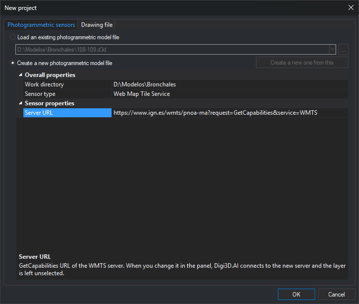
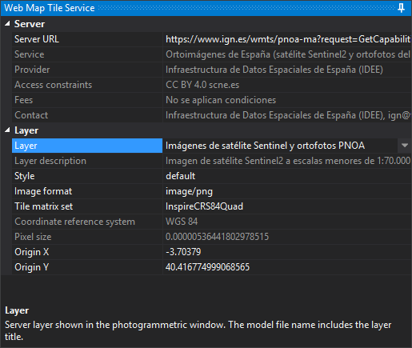

# Web Map Tile Service
<!-- id: sensor-wmts -->
<!-- origen: ac29df64d8722e90c00d55e6de72ba828983054f -->

The Web Map Tile Service sensor displays a WMTS (*Web Map Tile Service*) server layer in the photogrammetric window. The server supplies precomputed image tiles at zoom levels. The model has one image and no stereoscopy. Digi3D.AI requests visible-area tiles as you move through the model, treating each server tile matrix level as a pyramidal level.

## Creating the model

On [Photogrammetric sensors](../../cuadros-de-dialogo/nuevo-proyecto/sensores-fotogrametricos.md) in **New project**, choose **Create a new photogrammetric model file** and **Web Map Tile Service** as **Sensor type**. **Sensor properties** then contains only **Server URL**:



1. Enter the WMTS **GetCapabilities** URL in **Server URL**, for example IGN PNOA:

   ```
   https://www.ign.es/wmts/pnoa-ma?request=GetCapabilities&service=WMTS
   ```

2. Click **OK**. Digi3D.AI creates the model file and opens an empty photogrammetric window with **Web Map Tile Service** for layer selection. A server with only one layer, such as this PNOA example, selects it automatically (see [Opening the model](#opening-the-model)).

**OK** validates the URL without connecting. An empty value displays "Type the GetCapabilities URL of the WMTS server." An invalid URL (for example, starting with `ftp://`) displays "The WMTS server URL is not valid" with the URL. Both select **Server URL** and leave the dialog open. URLs without a scheme receive `http://`.

For an existing model, or one prepared with **Create a new one from this**, read-only **Layer**, **Style**, **Image format**, and **Tile matrix set** also appear with saved values. Change them in the photogrammetric window panel. Changing **Server URL** when creating from an existing model removes these properties and creates the new model without a layer.

## Model filename

Digi3D.AI proposes `servidor - capa.d3d` as the model filename, using the URL server name and layer title. For example, `www.ign.es - Imágenes de satélite Sentinel y ortofotos PNOA.d3d`. Without a layer selected, Digi3D.AI proposes `servidor.d3d`; for example, `www.ign.es.d3d`. When you create the model, Digi3D.AI shows the proposed name, without extension, in **.d3d file name** in [Create model](../../cuadros-de-dialogo/crear-modelo.md) or in the [Photogrammetric sensors](../../cuadros-de-dialogo/nuevo-proyecto/sensores-fotogrametricos.md) tab of New project, and you can change it.

* Characters Windows forbids in filenames are replaced: `\`, `/`, and `|` by `-`; `:`, `*`, `?`, and `%` by `_`; `"` by `'`; `<` and `>` by parentheses. Ports use `_`: `servidor_8080`.
* If the working directory already contains a Web Map Tile Service model for the same server, layer, style, format, and tile matrix set, Digi3D.AI proposes that file's name and, if you answer **Yes** to “Do you want to save the new model in the existing model file?”, reuses it, writing the new configuration. If an existing same-name file differs in any of these or belongs to another sensor, the new name becomes `servidor - capa (2).d3d`, `servidor - capa (3).d3d`, etc.
* Choosing another layer renames the model file for it, including the first selection in a model without a layer and automatic selection of the only server layer. Existing files are never overwritten by renaming: ` (2)`, ` (3)`, etc. are appended as needed. The photogrammetric window title reflects the new name.
* Custom filenames, or names from an older version using the entire connection string, are retained when changing layers.

## Opening the model

Digi3D.AI connects to the server. An invalid URL or unresponsive server displays an error and prevents opening. A model file without sensor configuration displays **The project file does not contain the \<connectionString\> node of the WMTS sensor**.

A model without a layer opens empty when several layers exist, awaiting panel selection. With only one layer, Digi3D.AI selects it as if chosen in the panel: take its first style, first supported image format, and first tile matrix set, rename the model to `servidor - capa.d3d`, save configuration, and display the image.

If the model layer, style, format, or tile matrix set is no longer available, the window opens empty and [Results](../../paneles/resultados.md) shows "The layer, style, format or tile matrix set of the model is not available on the server *server*. Choose them in the Web Map Tile Service panel." No layer is automatically selected in this case, even if only one is published.

Models from older versions open normally.

## Web Map Tile Service panel

Opening the model docks **Web Map Tile Service** on the right of the main window. Each Web Map Tile Service photogrammetric window has its own panel, closing with it. Panel changes apply immediately and are saved to the model file.



### Server

| Property | Description |
| :--- | :--- |
| **Server URL** | WMTS GetCapabilities URL. Changing it connects to the new server, clears layer selection and the photogrammetric window, and automatically selects the only layer if there is one, as on opening. Failure displays an error and retains the previous server |
| **Service** | Published service title. The description area shows the service description |
| **Provider** | Organization publishing the service |
| **Access constraints** | Published usage conditions. Selecting the property shows the complete text below |
| **Fees** | Published service price |
| **Contact** | Published contact person, email, and telephone |

**Service**, **Provider**, **Access constraints**, **Fees**, and **Contact** are read-only.

### Layer

| Property | Description |
| :--- | :--- |
| **Layer** | Displayed server layer. Titles are listed alphabetically; duplicate titles also show their identifier in parentheses. Other properties in this category remain hidden until a layer is chosen |
| **Layer description** | Published layer description. Read-only |
| **Style** | Tile request style, by identifier |
| **Image format** | Tile format. Only `image/jpeg` and `image/png` are offered, among those the layer supports |
| **Tile matrix set** | Layer *TileMatrixSet*. Each matrix in the set is a model pyramidal level |
| **Coordinate reference system** | Tile matrix set reference system, also used by the model. Shows its name or, if unrecognized, the server text. Read-only; determined by the matrix set |
| **Pixel size** | Pixel size of the most detailed matrix level, in reference system units. Read-only; determined by the server |
| **Origin X** and **Origin Y** | Opening coordinates, initially Madrid Puerta del Sol (see [Default origin](#default-origin)). Changing them moves the photogrammetric window there |

Selecting another layer preserves style, format, and tile matrix set if available in it; otherwise, the first published choice is selected.

When changing layer or tile matrix set:

* If the reference system is unchanged, the photogrammetric window stays in place.
* If it changes, the window moves to the new matrix set default origin, origin resets to that default, the drawing window recalculates the coordinate transformation, and the saved last position and scale factor in the previous system are removed.

If a change fails, "Unable to apply the change" appears with the reason, and the panel restores model values.

### Default origin

Until **Origin X** and **Origin Y** are changed, models open at Madrid Puerta del Sol (longitude -3.703790, latitude 40.416775 in ETRS89), transformed into the tile matrix set system. For example, PNOA `EPSG:25830` uses X = 440291.284 and Y = 4474254.600; `InspireCRS84Quad` uses X = -3.70379 and Y = 40.416775.

Digi3D.AI uses the tile matrix set center instead in these cases:

* The system is local because Digi3D.AI does not recognize it.
* Transformation from ETRS89 fails.
* Puerta del Sol lies outside the most detailed matrix level.
* Published *TileMatrixLimits* at that level exclude the tile containing Puerta del Sol.

The center is rounded to the nearest multiple of the most detailed pixel size. For example, `InspireCRS84Quad` center is X = 0, Y = 0.

## Reference system and coordinates

Digi3D.AI recognizes tile matrix set *SupportedCRS* in these forms: `EPSG:25830`, `urn:ogc:def:crs:EPSG::25830` (including versions such as `urn:ogc:def:crs:EPSG:6.18:25830`), `http://www.opengis.net/def/crs/EPSG/0/25830`, `CRS:84`, `OGC:CRS84`, `urn:ogc:def:crs:OGC:1.3:CRS84`, `urn:ogc:def:crs:OGC:2:84`, and `http://www.opengis.net/def/crs/OGC/1.3/CRS84`. An unrecognized system, or one unknown to the EPSG database, leaves the model in a local reference system in meters.

Model coordinates use reference system units, with east or longitude in X and north or latitude in Y:

* Geographic systems (CRS:84, EPSG:4326, EPSG:4258...) use degrees. Each level pixel size is its *ScaleDenominator* × 0.28 mm, divided by 111,319.49 m per degree, as defined by WMTS. For example, level 0 of IGN `InspireCRS84Quad` has 0.703125-degree pixels and spans 360 degrees.
* Geographic EPSG systems supply the upper-left matrix corner as latitude, longitude; Digi3D.AI reads it in that order. Projected systems whose EPSG definition places north first also retain their defined axis order.
* Projected systems use their linear units (meters, or feet for systems defined in feet).

## Tiles and cache

Received tiles are saved under Windows temporary folder **Caché WMTS**, grouped by server, layer, style, and tile matrix set. Cached tiles are not requested again.

If the server returns an image in the wrong format, the tile is red and [Results](../../paneles/resultados.md) shows the reason and request. If no data is returned, it is red without a message.
