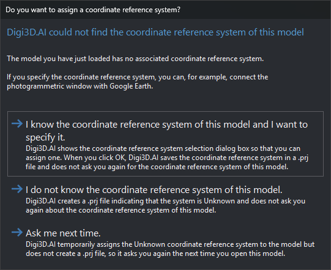

# Assigning a coordinate reference system to a drawing file
<!-- id: asignacion-src-archivo-dibujo -->
<!-- origen: e9d2a07e69042c1aa379c8e04ac43d18cf946f1f -->

Before the coordinate reference system assignment dialog was introduced, loading a project that provided no coordinate reference system (CRS) made Digi3D.AI automatically assign a local (unknown) system to loaded models.

If you knew the system used by the project's orientations and wanted to assign it (for example, to connect to Google Earth), you had to create a .prj file with the same name as the aerotriangulation file and specify the appropriate coordinate reference system.

Digi3D.AI allows you to assign the CRS without manually creating the .prj file.\
When loading a model with no associated coordinate reference system, the program displays this dialog:

The dialog lets you choose how Digi3D.AI assigns the coordinate reference system to the model.

## Video

This video shows how to assign the coordinate reference system when loading a model: [https://youtu.be/2IB5l2D2nNc](https://youtu.be/2IB5l2D2nNc)
