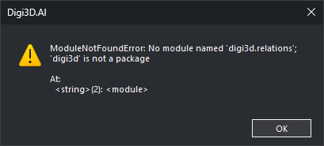
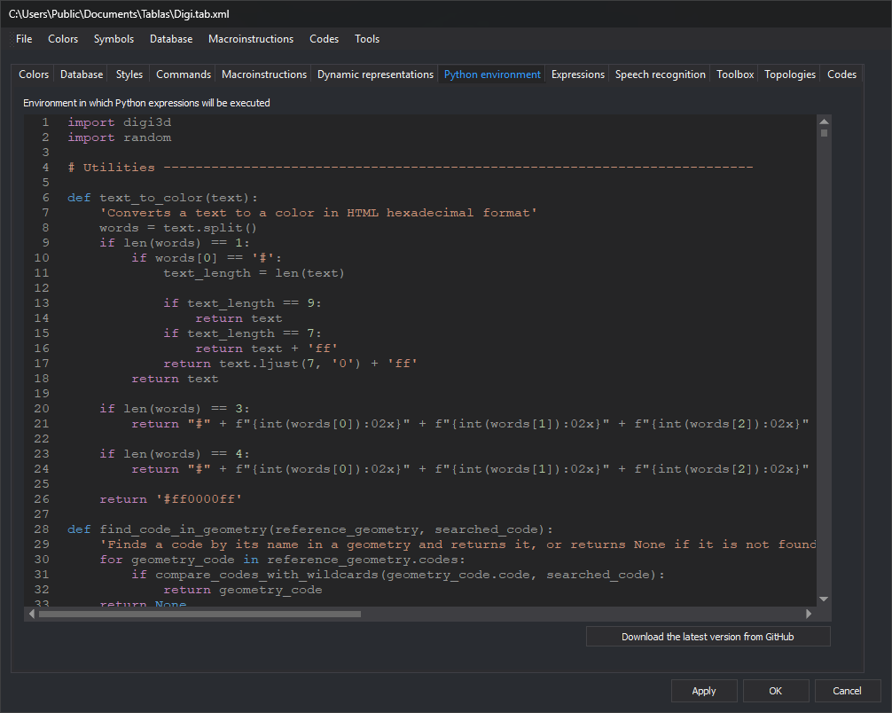

# Update a code table's Python quality controls
<!-- id: actualizar-guiones-python -->
<!-- origen: abc923943b793bcd687b75d1b2ebabcb8b6aeb8f -->

Python quality controls in codes tables from earlier Digi3D versions are incompatible with Digi3D.AI. Opening a drawing with such a table, or analyzing quality controls, produces an error such as:



```text
ModuleNotFoundError: No module named 'digi3d.relations'; 'digi3d' is not a package
```

Replace the table's Python environment with the latest [Digi21 quality controls](https://github.com/digi21/Guiones-Control-Calidad-Python-Digi3D).

## Steps

1. **Back up the codes table file.** New controls do not work in earlier Digi3D versions: use the backup if you continue using those versions.
2. Open the table with [Code table editor](../referencia/editor-de-tablas-de-codigos/README.md).
3. Select [Python environment](../referencia/editor-de-tablas-de-codigos/pestanas/entorno-python.md).
4. Click **Download the latest version from GitHub** below the editor, replacing tab contents.
5. Click **Apply**.
6. Click **OK**.



Reopening the drawing in Digi3D.AI restores working quality controls.

> Downloading in step 4 deletes custom functions. Copy them beforehand and append them afterwards. Functions using old modules or names (such as `digi3d.relations` or `g.codes[0].name`) require adaptation to the [Digi3D.AI Python API](../programacion/python/controles-de-calidad/README.md). [Changed Python API names](#changed-python-api-names) lists replacements or missing equivalents.

## Errors after replacing the environment

Opening a drawing executes the codes table's Python environment in interpreter module `__main__`. Running [ON\_PYTHON\_EXPRESSION](../referencia/ventana-de-dibujo/ordenes/o/on_expresion_python.md), [OFF\_PYTHON\_EXPRESSION](../referencia/ventana-de-dibujo/ordenes/o/off_expresion_python.md), [ON\_ONLY\_PYTHON\_EXPRESSION](../referencia/ventana-de-dibujo/ordenes/o/on_solo_expresion_python.md) and [SELECT\_PYTHON\_EXPRESSION](../referencia/ventana-de-dibujo/ordenes/s/selecciona_expresion_python.md) from the command line, menus or macro instructions evaluates their expressions, including table [selections](../referencia/editor-de-tablas-de-codigos/pestanas/selecciones.md), in `__main__`. Expressions can therefore use `g`, built-ins such as `len` or `type`, and environment names. Old expressions and custom functions produce these errors if they use names absent from the downloaded environment or changed in Digi3D.AI.

Expression errors display a Python error message. In the failing file, ON\_PYTHON\_EXPRESSION and OFF\_PYTHON\_EXPRESSION leave visibility unchanged for that expression (with multiple `#` selections, apply those that succeed). ON\_ONLY\_PYTHON\_EXPRESSION hides everything except geometries passing another successful `#` selection; SELECT\_PYTHON\_EXPRESSION sends an empty selection to the active command. Inside a [macro instruction](../referencia/ordenes/formas-de-ejecutar-una-orden/ejecutar-una-orden-desde-la-linea-de-comandos/macroinstrucciones.md) (`@`), the next command runs after the message closes. For example, an OFF\_PYTHON\_EXPRESSION error while hiding texts does not stop subsequent topology creation; the topology runs without OFF\_PYTHON\_EXPRESSION having hidden texts in failing files. See [ON\_PYTHON\_EXPRESSION](../referencia/ventana-de-dibujo/ordenes/o/on_expresion_python.md#errors).

### NameError when using Text, Line, Point, Polygon or Complex

Expressions or called environment functions using a geometry type without `digi3d.` fail if the environment does not import that name. The message begins:

```text
NameError: name 'Text' is not defined
```

The quoted name is undefined: `Text`, `Line`, `Point`, `Polygon`, `Complex` or another `digi3d` name. Older environments could use `from digi3d import *`, defining all public `digi3d` names. The GitHub environment starts with `import digi3d` and `import random`, without `from digi3d import *`, so module names require `digi3d.`. This OFF\_PYTHON\_EXPRESSION expression fails:

```text
OFF_PYTHON_EXPRESSION=type(g) is Text and "_A_" in g.codes[0].name
```

Fix it in either way:

* Below the first `import digi3d`, import names required by expressions and functions:

  ```python
  import digi3d
  from digi3d import Point, Text, Line, Polygon, Complex
  ```

  Add other reported names from [`digi3d`](../programacion/python/referencia/digi3d/README.md) to the list.
* Prefix unqualified `digi3d` names with `digi3d.`: `type(g) is digi3d.Text`.

After editing, click **Apply** and **OK** in Code table editor, then reopen the drawing to execute the changed environment.

> `from digi3d import *` also resolves the error, but defines `Warning` as `digi3d.TaskType.Warning`. Expressions and functions using `Warning` then receive `digi3d.TaskType.Warning` instead of Python's `Warning` exception. The downloaded environment does not use that exception. Import `digi3d` names individually if your functions use Python `Warning`.

### AttributeError when reading a code's name

After resolving `NameError`, the example raises `AttributeError` at `g.codes[0].name` for the first text having a code. The error contains:

```text
object has no attribute 'name'
```

In Digi3D.NET 2023–2025, `g.codes` contained `digi3d.Code`, storing code text in `name`. In Digi3D.AI, `g.codes` contains [FeatureCode](../programacion/python/referencia/digi21.base/featurecode.md), storing it in `code`. `FeatureCode` has no `name`.

Replace `.name` with `.code` for geometry codes. With `from digi3d import Point, Text, Line, Polygon, Complex` in the environment:

```text
OFF_PYTHON_EXPRESSION=type(g) is Text and "_A_" in g.codes[0].code
```

Replace `.name` only on codes: `Command.name` and `Camera.name` still exist.

## Changed Python API names

Lists `digi3d` names from Digi3D.NET 2023–2025 absent from Digi3D.AI and their replacements, where available. Other class, property, method, function and enumeration names remain. This compares names, excluding constructor argument changes.

| Digi3D.NET 2023–2025 | Digi3D.AI |
| :--- | :--- |
| `digi3d.Code` | `digi3d.FeatureCode` |
| `Code.name`, such as `g.codes[0].name` | `FeatureCode.code`, such as `g.codes[0].code` |
| `Geometry.drawing_file` | `Geometry.file` |
| `DrawingFile.min` and `DrawingFile.max` | Unavailable. |
| `digi3d.CoordinatesIterator` and `digi3d.GeometriesIterator` | Unavailable. Use `for` on a geometry or drawing file to iterate vertices or geometries. |
| `digi3d.relations` submodule | Geometry methods. See [Geometry relationships](#geometry-relationships). |
| `digi3d.CardinalPoint` | `digi3d.StandardViewpoint`. `Up` and `Down` become `Top` and `Bottom`; others keep their names. |
| `Camera.rotate_cardinal_point(cardinal_point)` | `Camera.rotate_standard(viewpoint)` |
| `Camera.rotation` | `Camera.rotations` |
| `Camera.frustrum_dimensions` | `Camera.frustum_dimensions` |
| `Camera.set_ortographic(min, max)` | `Camera.set_orthographic(min, max)` |
| `Camera.znear` and `Camera.zfar`, and `Camera.set_conic` arguments `znear` and `zfar` | `Camera.z_near` and `Camera.z_far`, and `Camera.set_conic` arguments `z_near` and `z_far` |
| `DrawingView.blendind` | `DrawingView.blending` |
| `DrawingView.paralelize_line_when_finish_line` | `DrawingView.parallelize_line_when_finish_line` |
| `digi3d.Inside`, `digi3d.Outside` and `digi3d.Edge` | `digi3d.PointLineRelativePosition.Inside`, `digi3d.PointLineRelativePosition.Outside` and `digi3d.PointLineRelativePosition.Edge` |
| `digi3d.N`, `digi3d.S`, `digi3d.E`, `digi3d.W` and `digi3d.C` | `digi3d.TextJustification.N`, `digi3d.TextJustification.S`, `digi3d.TextJustification.E`, `digi3d.TextJustification.W` and `digi3d.TextJustification.C` |
| `digi3d.NE`, `digi3d.NW`, `digi3d.SE` and `digi3d.SW` | `digi3d.StandardViewpoint.NE`, `digi3d.StandardViewpoint.NW`, `digi3d.StandardViewpoint.SE` and `digi3d.StandardViewpoint.SW`. For text justification, use `digi3d.TextJustification.NE`, `digi3d.TextJustification.NW`, `digi3d.TextJustification.SE` and `digi3d.TextJustification.SW`. |
| `digi3d.Up`, `digi3d.Down`, `digi3d.Left`, `digi3d.Right`, `digi3d.Front`, `digi3d.Back` and `digi3d.Free` | `digi3d.StandardViewpoint.Top`, `digi3d.StandardViewpoint.Bottom`, `digi3d.StandardViewpoint.Left`, `digi3d.StandardViewpoint.Right`, `digi3d.StandardViewpoint.Front`, `digi3d.StandardViewpoint.Back` and `digi3d.StandardViewpoint.Free` |

Digi3D.NET 2023–2025 exported `PointLineRelativePosition`, `TextJustification` and `CardinalPoint` values at `digi3d` module level. `from digi3d import *` imported them without prefixes (such as `Inside`). Since `CardinalPoint` followed `TextJustification`, `digi3d.NE`, `digi3d.NW`, `digi3d.SE` and `digi3d.SW` were `CardinalPoint` values. Digi3D.AI exposes `PointLineRelativePosition`, `TextJustification` and `StandardViewpoint` values only inside their enumerations, requiring prefixes such as `digi3d.PointLineRelativePosition.Inside`.

### Geometry relationships

`digi3d.relations` grouped relationships in classes by both geometry types, exposing functions taking both geometries. Digi3D.AI equivalents are methods on the first geometry taking the second: `digi3d.relations.LineLine.join(a, b)` becomes `a.touches(b)`. [Geometry](../programacion/python/referencia/digi21.base/geometry.md#spatial-relations) documents each.

| Digi3D.NET 2023–2025 (`digi3d.relations`) | Digi3D.AI |
| :--- | :--- |
| `PointPoint.disjoint(a, b)`, `PointLine.disjoint(a, b)`, `PointArea.disjoint(a, b)`, `LineLine.disjoint(a, b)`, `LineArea.disjoint(a, b)` and `AreaArea.disjoint(a, b)` | `a.disjoint(b)` |
| `PointPoint.coincident(a, b)`, `PointLine.coincident(a, b)` and `PointArea.coincident(a, b)` | `a.coincident(b)` |
| `PointLine.coincident_and_terminate(a, b)` | `a.coincident_and_terminates(b)` |
| `PointArea.within(a, b)`, `PointArea.withincoincident(a, b)`, `LineArea.within(a, b)` and `AreaArea.within(a, b)` | `a.within(b)` |
| `AreaArea.completely_within(a, b)` | `a.completely_within(b)` |
| `LineArea.adjacent(a, b)` and `AreaArea.adjacent(a, b)` | `a.adjacent(b)` |
| `AreaArea.outer_ring_adjacent(a, b)` | No equivalent method. |
| `LineLine.join(a, b)`, `LineArea.join(a, b)` and `AreaArea.join(a, b)` | `a.touches(b)` |
| `LineLine.endpoint_join_endpoint(a, b)` and `LineArea.endpoint_join(a, b)` | `a.endpoint_touches(b)` |
| `LineLine.endpoint_join_excluding_endpoints(a, b)` | `a.endpoint_touches_interior(b)` |
| `LineArea.terminates_within(a, b)` | `a.terminates_within(b)` |
| `LineLine.across(a, b)` and `LineArea.across(a, b)` | `a.crosses(b)` |
| `LineLine.get_cross_vertices(a, b, parar)` | `a.cross_vertices(b, parar)`. Accepts only two `Line` geometries. |
| `LineLine.overlap(a, b)` | `a.overlaps(b)` |
| `AreaArea.overlap(a, b)`, returning a tuple whose first element indicated overlap | `a.overlaps(b)`, returning `True` or `False`. Replace `AreaArea.overlap(a, b)[0]` with `a.overlaps(b)`. |
| `LineLine.equal(a, b)` and `AreaArea.equal(a, b)` | `a.equals(b)` |

`PointArea`, `LineArea` and `AreaArea` treated closed `Line` geometries as areas. Digi3D.AI chooses based on both types:

* Treats a `Line` argument as an area in `within`, `adjacent`, `terminates_within`, `completely_within` and any method called on `Polygon`.
* Treats the `Line` receiving the method as a line, and `Line` arguments as lines in methods other than `within`, `adjacent`, `terminates_within` and `completely_within` when not called on `Polygon`.
* Raises `TypeError` for undefined type combinations. For example, `linea.overlaps(poligono)` produces:

  ```text
  TypeError: La relacion 'overlaps' no esta definida para esa combinacion de tipos de geometria.
  ```

To treat a closed line as an area where these rules treat it as a line, create a polygon from its vertices first, then call the method on it or pass it as the argument:

```python
poligono = digi3d.Polygon((), list(linea))
```

## See also

* [Quality controls](../programacion/python/controles-de-calidad/README.md)
* [Python environment tab](../referencia/editor-de-tablas-de-codigos/pestanas/entorno-python.md)
* [Update selection and command Python expressions](actualizar-expresiones-python.md)
* [Geometry](../programacion/python/referencia/digi21.base/geometry.md)
