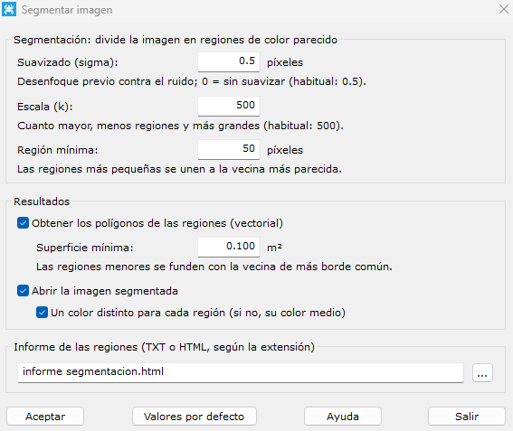

# Image segmentation
<!-- id: segmentar-imagen -->
<!-- origen: 6747d4cc85a55112051c83bedf8d4dfafde00e30 -->

[Compute](/mdtopx/fichas-de-herramientas/ficha-de-herramientas-imagen/imagen-calcular.md)

This tool divides an image into regions of similar colour. If requested, it also obtains the polygons of those regions, georeferenced and with the colour statistics of each one. It is useful, for example, to separate roofs, roadway, vegetation or grass in an orthophoto and take their outlines to a drawing.

It can be used from the view of an image, on that image, or from the view of a project, on the images of the project that you choose.

## How it works

1. The image is smoothed with a Gaussian filter, so that noise does not split the regions.
2. Neighbouring pixels of similar colour are grouped with the Felzenszwalb and Huttenlocher algorithm. Two neighbouring zones are merged if the colour difference along their border does not exceed the colour variation inside each of them plus a margin. The margin is the **Scale** divided by the number of pixels of the zone: small zones merge easily, and a large uniform zone does not merge with a different one.
3. Regions with fewer pixels than the **Minimum region** are merged with the most similar neighbour.
4. If polygons are requested, the outline of each region is traced. The polygons cover the image with no gaps or overlaps: each border is shared exactly by the two neighbouring regions, and a region that surrounds another one has the hole as an island. Regions with less area than the **Minimum area** are merged with the neighbour with which they share the longest border.

In a colour image the RGB colour is compared; in a greyscale image, the grey level. In a spherical image, the left and right edges are treated as neighbours, because the panorama covers the full turn.

Regions with no data (all white) or completely black do not produce a polygon.

## Results

* **Segmented image**: if **Open the segmented image** is checked, a new document is opened, «Segmentación de» followed by the name of the image, with each region painted in a different colour or in its mean colour.
* **Polygons**: if **Obtain the polygons of the regions** is checked, a new drawing document is opened. From an image it is called «Límites de» followed by the name of the image; from a project, «Vectorización de» followed by the name of the project. The outer outline of each region has the code LIMEXT, and its islands, the code LIMINT.
* **Region table**: from an image, the drawing has a table with one row per region, and each polygon has an attribute with its row. The columns are the following:
  * `index`: number of the region.
  * `mediaR`, `mediaG`, `mediaB` and `dvR`, `dvG`, `dvB`: mean and standard deviation of each band.
  * `cPixel`: number of pixels.
  * `minR`, `maxR`, `minG`, `maxG`, `minB`, `maxB`: minimum and maximum of each band.
  * `minH`, `maxH`, `mediaH`, `dvH`: minimum, maximum, mean elevation and standard deviation of the region, if the image has a depth map.

  From a project there is no table: each polygon carries the values in its attributes. Table 2 is the number of the region, and tables 3 to 15, in this order, the mean and the deviation of R, G and B, the number of pixels and the minimum and maximum of R, G and B.
* **Report**: if a file name is entered, a report is saved with one row per polygon: region, whether it is outer or island, mean and deviation of each band, pixels, minimum and maximum of each band, elevations, area, perimeter and number of vertices. If the name ends in `.html` or `.htm`, the report is written in HTML, with a summary of the image and of the parameters and a sample of the colour of each region; otherwise, it is written as text.

The [Output pane](../introduccion/paneles-de-la-aplicacion/panel-resultados.md) shows the number of regions found and the path of the report.

### Georeferencing of the polygons

* **Orthophoto**: the vertices are taken to ground coordinates with the origin and the pixel size of the image.
* **Conical image**: each vertex is projected onto the horizontal plane at the mean elevation of the orientation of the image. The minimum area is measured on that plane.
* **Image with a depth map** (orthophotos and spherical images): the vertices take the elevation of the depth map. Polygons that fall outside the map are discarded.
* **Spherical image without a depth map**: the polygons are in pixel coordinates.

## Parameters

* **Smoothing (sigma)**: Previous blur against noise, in pixels. With 0 there is no smoothing. The usual value is 0.5.
* **Scale (k)**: The higher it is, the fewer and larger the regions. The usual value is 500.
* **Minimum region**: Number of pixels below which a region is merged with the most similar neighbour.
* **Obtain the polygons of the regions (vector)**: Creates the drawing with the polygons.
* **Minimum area**: Area in m² below which a region is merged with the neighbour with which it shares the longest border. With 0 no region is merged.
* **Open the segmented image**: Creates the image document with the regions painted.
* **A different colour for each region**: If checked, each region of the segmented image is painted in a different colour; otherwise, in its mean colour.
* **Report of the regions**: File of the report. The **...** button lets you choose it. If it is left empty, there is no report. By default, the name of the image, or of the project, with the TXT extension is proposed. If the name has no folder, the report is saved in the folder of the image or of the project.
* **Default values**: Puts the usual values in the dialog box.

## From a project

When the dialog box is accepted, the tool asks for the images of the project to be segmented. The images are processed in parallel, as many at a time as fit in the free memory: each image needs about 80 bytes per pixel.

Polygons are only obtained for georeferenced images that are orthophotos or conical images, or that have a depth map. The polygons of all the images go to the same drawing. The areas shared by two overlapping images appear twice, once per image.

If a report is requested, a single one is written for all the images, in the order of the list. The HTML report starts with a summary and an index with a link to each image, followed by one section per image. After the summary, the report lists the images that have not been processed and the reason: they lack georeferencing or depth, there was not enough memory, the process was cancelled or their polygons do not fit with the decimals of the result drawing.

See also:

* [Raster to Vector](vectorizar.md)
* [Generate image boundaries](generar-limites-de-imagen.md)
* [NDVI](ndvi.md)
