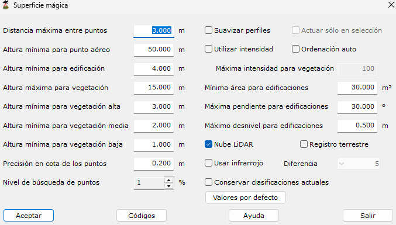

# Magic Surface
<!-- id: superficie-magica -->
<!-- origen: c00edddd90874f9287353334d12f65f18dca7759 -->

[LiDAR classification tab](/mdtopx/fichas-de-herramientas/ficha-de-herramientas-clasificar-lidar.md)

This tool automatically finds and classifies LiDAR points. It combines algorithms and tools of the program and selects the algorithms and parameters according to the file type and the area type, so you do not have to decide them for each run.

It works with an open point cloud file or with a project. Besides ground, vegetation and buildings, it classifies bridges and footbridges, roads and vehicles, and the wires and towers of power lines, if their check boxes are selected (see [What it classifies](#what-it-classifies)), and when it finishes it groups the points into [objects](#objects). With very dense clouds, such as those of a terrestrial scanner, it works differently (see [Very dense clouds](#very-dense-clouds-terrestrial-scanner)).

Parameters:

* **Max distance among points**: maximum distance between two points for them to be considered neighbors in the area. A value of 2 or 3 times the nominal spacing between scanned points is recommended.
* **Min height to aerial points**: minimum height difference a point must have with its surroundings to be classified as an aerial point. If you enter 0, the tool does not apply this minimum height criterion.
* **Min height to buildings**: minimum height difference a point must have with its surroundings to be classified as a building point. If you enter 0, the tool does not apply this minimum height criterion.
* **Max height to high vegetation**: maximum height difference a point can have with its surroundings to be classified as vegetation. If you enter 0, the tool does not apply this maximum height criterion. The crowns of trees taller than this value are also high vegetation if there is vegetation underneath them and they do not form a plane.
* **Min height to high vegetation**: minimum height difference a point must have with its surroundings to be classified as high vegetation. If you enter 0, the tool does not apply this minimum height criterion.
* **Min height to medium vegetation**: minimum height difference a point must have with its surroundings to be classified as medium vegetation. If you enter 0, the tool does not apply this minimum height criterion.
* **Min height to low vegetation**: minimum height difference a point must have with its surroundings to be classified as low vegetation. If you enter 0, the tool does not apply this minimum height criterion.
* **Point height accuracy**: precision of the elevation definition.
* **Point Search level**: a value from 1 to 10. Lower values produce a more exhaustive search because the tool repeats some classification processes.
* **Smooth profiles**: if the data were acquired along scan lines, smooths the points before classification to remove irregularities. Smoothing can also remove characteristic terrain features.
* **Only in the selection**: if points were selected on screen before running the tool, the user can choose to calculate only with the selected points.
* **Use intensity**: select this option to use the intensity field of each point in the classification. Intensity helps distinguish the ground from the objects on it when their intensity values differ substantially, as in a plantation (olive grove, vineyard, etc.). Using intensity is not recommended in other situations.
* **Auto sort**: select this option to sort the points by their Global Positioning System (GPS) time before classification. Sorting is useful when the cloud combines several groups of points.
* **Max intensity value of vegetation**: when **Use intensity** is selected, set the maximum intensity for a point to be classified as vegetation, from 0 to 255.
* **Min surface area of buildings**: to identify buildings correctly, you can indicate a minimum surface area. Below this value, the area is not considered a building.
* **Max surface slope of buildings**: maximum slope of a surface that the tool may classify as a building.
* **Max height difference in buildings**: finally, you can indicate the maximum height difference that can exist between points belonging to the same area that may be a building.
* **LiDAR point cloud:** select it if the cloud comes from laser measurements, or clear it if the cloud comes from photogrammetric multi-image correlation (see [Photogrammetric clouds](#photogrammetric-clouds)). With a file, the check box is set according to the cloud: it is LiDAR if its points have GPS time or intensity, and photogrammetric if they have neither and have color. With a project, it is set manually.
* **Terrestrial register**: select this option if the acquisition is terrestrial, since the resolution and precision are much higher than in the airborne case.
* **Use infrared**: select this option to calculate the normalized difference vegetation index (NDVI) from the near infrared (IR) and red (R) values of each point. If the cloud has the NIR field of the LAS (point formats 8 and 10, such as PNOA 2024), the tool uses that infrared with the red of each point's color and leaves points without NIR untouched. Otherwise each point must have false color with the infrared-red-green (IR-R-G) triplet. The tool uses NDVI to distinguish vegetation from buildings (see [With infrared](#with-infrared)).
* **Difference**: when **Use infrared** is selected, set the NDVI threshold in elevenths: with 3, the threshold is 3/11 (0.27). Use a low value if the infrared value is not well defined in the vegetation areas (for example, deciduous vegetation in a winter flight), and a high value otherwise.
* **Keep current classifications**: the cloud is always classified from scratch, but when the process finishes, the points that already had a class (any except 0 and 1, unclassified) recover it. Manual edits are preserved. Points whose previous class was neither 0 nor 1 are excluded from the new objects, and the tool neither removes the synthetic points from the previous run nor adds new ones. Clear **Keep current classifications** to apply the new classification to every point.
* **Vector at the end (building footprints)**: if selected, when the classification finishes the tool calculates, from the building and ground classes of the points, the footprint of each building with straight sides and those of its courtyards, at ground elevation, and opens them in a new document titled "Vector of" followed by the title of the source document. The [Results pane](../../../introduccion/paneles-de-la-aplicacion/panel-resultados.md) shows the number of buildings, how many have straight sides, the number of courtyards and the cell size. If there are no buildings, no document is created, and if the calculation fails, the classification is kept. With a project, the tool calculates the footprints only when the project files are saved, and it calculates them using all the files together. The **Vector at the end (building footprints)** check box is selected by default. To calculate the footprints after the classification, without modifying the classes of the points, use the **Magic surface vector** command.
* **Classes besides the ASPRS ones**: the **Bridges and footbridges**, **Roads and vehicles** and **Wires and pylons** check boxes indicate whether the tool searches for those classes, which are not in the ASPRS LAS specification. Each check box shows in brackets the codes they are classified with, which you change with the [**LiDAR classes...**](codigos-lidar.md) button. If you clear a check box, the tool does not search for that class and its points keep the class that corresponds to them among the others (ground, vegetation, building, other...). The three check boxes are selected by default. With a very dense cloud, the tool does not search for bridges or roads even if their check boxes are selected (see [Very dense clouds](#very-dense-clouds-terrestrial-scanner)).
* **Default values**: sets the default values in all the parameters. It does not change the [codes](codigos-lidar.md), which have their own dialog, nor the **Only in the selection**, **Keep current classifications** and **Vector at the end (building footprints)** check boxes. If a value in the dialog is not valid, the dialog reports it and leaves all the values unchanged.
* [**LiDAR classes...**](codigos-lidar.md): opens the dialog where you change the classification codes of Noise, Wall, Aerial, Other, Bridges, Road, Vehicles, Wires and Towers.

The default values are:

| Parameter | Default |
|---|---|
| Max distance among points | 3 m |
| Min height to aerial points | 50 m |
| Min height to buildings | 4 m |
| Max height to high vegetation | 15 m |
| Min height to high vegetation | 3 m |
| Min height to medium vegetation | 2 m |
| Min height to low vegetation | 1 m |
| Point height accuracy | 0.2 m |
| Point Search level | 1 |
| Max intensity value of vegetation | 100 |
| Min surface area of buildings | 30 m² |
| Max surface slope of buildings | 30º |
| Max height difference in buildings | 0.5 m |
| Difference (infrared) | 3 |

The program starts processing the current file and shows partial results in the [Results pane](../../../introduccion/paneles-de-la-aplicacion/panel-resultados.md) of the program. When you click **Cancel**, the tool also stops in the middle of the long steps, and the program asks whether to keep the calculations generated up to that moment. In addition, if the current document view displays the points by the LiDAR classification parameter, the view is updated progressively so you can see the progress of the tool in real time.

## What it classifies

Each class is assigned the code it has in the dialog opened by the [**LiDAR classes...**](codigos-lidar.md) button:

| Class | Default | What it is |
|---|---|---|
| Ground | 2 | The terrain. |
| Low, medium and high vegetation | 3, 4 and 5 | The vegetation, according to its height above the ground. |
| Building | 6 | Roofs and covers. |
| Noise | 7 | Points far below their surroundings: measurement errors. |
| Wall | 91 | Facades. |
| Aerial | 18 | Points far above their surroundings. |
| Wires | 14 | The conductors and guard wires of power lines. |
| Towers | 15 | The towers and poles of power lines. |
| Road | 11 | Streets and roads. |
| Other | 80 | What is neither ground, vegetation nor building, such as street furniture, gantries over the road or, with infrared, pergolas. |
| Vehicles | 82 | Vehicles on the road or next to it. |
| Bridges | 17 | The decks of bridges and footbridges. |

### Ground on hills and hillocks

On hills and hillocks with steep slopes or terrace walls, the tool also searches for ground along ramps, paths and slopes that rise from the surrounding terrain, and not along facades or tree crowns. This way, the top of a hillock is classified as ground, and any buildings on it are classified as buildings.

### Bridges and footbridges

These are bridges:

* The decks of bridges over watercourses and roads: a surface that drops vertically 4 m or more on both sides down to the same low level, which continues below the deck (the watercourse or the road), with an area of at least 100 m² and a length of at least 15 m, and whose two ends end on the terrain, including bridge decks whose ends connect to street level by stairs or ramps. The tool also classifies the parapets and railings of bridge decks as bridges.
* Pedestrian footbridges, up to 4 m wide, with the terrain 2.5 m or more below on both sides.

An embankment with vertical walls 4 m or more high on both sides looks the same as a deck from above and may be classified as a bridge.

### Road

The road is the nearly horizontal, smooth ground that, by its intensity and color, is asphalt. The tool rebuilds the road mask as a network of streets: each street has a smoothed center line and two edges parallel to it.

In the urban area (where buildings take up a quarter or more of the surroundings), the tool classifies as road all the ground between the facades, sidewalks included, with buildings on both sides 50 m or less apart and in street networks of 5,000 m² or more. Closed block courtyards are not road; those open to the street through a doorway, and gardens between facades, are.

Outside the urban area, the tool does not classify as road the connected groups of road that reach neither the streets of the urban area nor the edge of the cloud and whose center line is shorter than 200 m.

### Vehicles

Vehicles are groups of points between 0.3 and 4.5 m above the ground, up to 20 × 4 m, on the road detected as asphalt or less than 5 m from it, that do not touch anything higher or the vegetation at the margins. Vehicles are not searched for in the streets of the urban area that were not detected as asphalt.

### Gantries over the road

Sign gantries and signs that span the road become other points, even if they look like vegetation from above: groups of 15 points or more, 4.5 m or more above the road, 8 m or longer and 3 m wide or less, across the street (at 45º or more to it), with no vegetation attached and with depth, that is, with the chords of the truss one above the other (a wire crossing the street has none). With **Use infrared**, their median NDVI must also be below 0.15.

### Wires and towers

Power lines are searched for with the same procedure as the [Power lines](../../generar/lineas-electricas.md) tool: the conductors and guard wires become **Wires**, and the towers and poles become **Towers**. In the gaps of the conductors, synthetic points are added, with the class of the wires plus 32 and marked as synthetic. When the tool is repeated, the synthetic points from the previous run are removed and the new ones are added. With **Keep current classifications** or with a selection, synthetic points are neither removed nor added.

### With infrared

With **Use infrared**, NDVI only rescues vegetation: building, other and possible high vegetation points with an NDVI above **Difference**/11 become high vegetation, in two passes: in the first, if their infrared is 75 or more; in the second, 25 or more. Then, building points that do not form surfaces larger than **Min surface area of buildings** become other points. NDVI never turns vegetation points into other points.

In addition, flat structures left as vegetation without the NDVI of vegetation, such as pergolas, become other points: groups of 10 points or more and 6 m² or more, on a plane (0.25 m or less root mean square) and with a median NDVI below 0.06. NDVI alone is not enough: in a winter flight, deciduous trees have an almost null NDVI, but they do not form a plane.

### Photogrammetric clouds

With the **LiDAR point cloud** check box cleared, the cloud comes from photogrammetric multi-image correlation, with no returns or intensity. In addition:

* What is not flat at a 1 m scale is neither a building nor a bridge: the tree masses that are classified as buildings become high vegetation.
* Unclassified points, points of the **Other** class and points of the **Wall** class more than 3 m in plan from a building take the most frequent class (vegetation or building) in the adjacent 1 m voxels.

### Very dense clouds (terrestrial scanner)

A cloud is very dense when more than half of its points are in areas with more than 500 points/m², like the clouds of a terrestrial or a mobile scanner. Aerial clouds, LiDAR or photogrammetric, do not reach that density. With a very dense cloud:

* The tool classifies a sample of the cloud, with one point per 10 cm cube, and each point of the cloud takes the class and the object of the point of its cube. This way, a cloud of 80 million points is classified in a few minutes.
* It does not search for bridges or roads: the terrain steps of a forest on a slope looked like bridge decks.
* A point is not ground if it has, below it in its 10 cm column, at least 3 points more than 0.3 m below: the trunk of a tree is not ground. Those points become low, medium or high vegetation according to their height above the points below. In the first 50 cm of the trunk some ground may remain.
* A wall has to form, with the points around it within 1 m, an almost vertical plane at least 0.8 m wide and thin compared to that width. Trunks, posts and narrow pillars do not form it and become medium vegetation. Walls more than about 35 cm thick scanned from both sides and trunks more than 1.2 m in diameter scanned from one side only may be misclassified.

Where the scanner does not see the terrain, for example under dense canopies, there is no ground to classify: the cloud only has canopy points.

## Objects

After the classification, the tool groups the points into objects, which you can see and select with **Edit objects**: each building with its roof and walls, each tree or mass of crowns with its medium and high vegetation, each vehicle, each bridge, each group of other points, each wire section and each tower. Ground, road, low vegetation, unclassified points, noise points and aerial points do not form objects.

The tool replaces the objects the cloud had with the new objects. With a selection, the tool replaces only the existing objects that have some selected point. With **Keep current classifications**, the tool replaces only the existing objects that share some point with the new objects. With a file, the program saves the objects when the cloud is saved. With a project without a selection, the program saves the objects of each cloud in an `.OBJ` file in the same folder as the cloud file. With a project with a selection, the program does not change the objects stored for each project file.

See also:

* [Find elevated points](/mdtopx/modulo-laser/buscar-puntos/buscar-puntos-elevados.md)
* [Find isolated points](/mdtopx/modulo-laser/buscar-puntos/buscar-puntos-aislados.md)
* [Find airborne points](/mdtopx/modulo-laser/buscar-puntos/buscar-puntos-aereos.md)
* [Find sunken points](/mdtopx/modulo-laser/buscar-puntos/buscar-puntos-hundidos.md)
* [Find points on flat surfaces](/mdtopx/modulo-laser/buscar-puntos/buscar-puntos-en-superficies-planas.md)
* [Find points on walls](/mdtopx/modulo-laser/buscar-puntos/buscar-puntos-en-paredes.md)
* [Find ground points only](../solo-suelo.md)
* [Find neighboring points](../buscar-vecinos.md)
* [Find points by infrared](/mdtopx/modulo-laser/buscar-puntos/buscar-puntos-segun-infrarrojo.md)
* [Find gaps](/mdtopx/modulo-laser/buscar-puntos/buscar-huecos.md)
* [Find points by surface area](../buscar-puntos-segun-area.md)
* [Find points on user planes](../../formas-geometricas/buscar-puntos-sobre-planos.md)
* [Power lines](../../generar/lineas-electricas.md)
