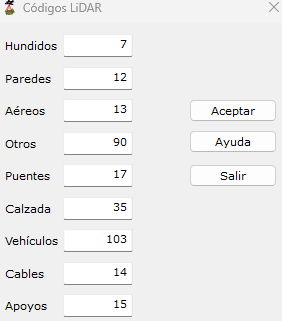

# LiDAR codes
<!-- id: codigos-lidar -->
<!-- origen: 8d8340dc764e896b90a11edbc7b35b6ea4307627 -->

[Magic Surface](/mdtopx/modulo-laser/buscar-puntos/superficie-magica/)

This dialog lets you change the classification codes of Noise, Wall, Aerial, Other, Bridges, Road, Vehicles, Wires and Towers.

Classification codes:

| Code | Default | What it is |
|---|---|---|
| **Noise** | 7 | Points whose elevation is far below that of their surroundings, caused by a measurement error. |
| **Wall** | 91 | Points measured on building facades. |
| **Aerial** | 18 | Points recorded with an elevation far above that of their surroundings due to a measurement error or to the beam bouncing off an airborne object. |
| **Other** | 80 | Points that could not be identified as vegetation, ground or buildings, for example, street furniture. |
| **Bridges** | 17 | The decks of bridges over watercourses and roads and the footbridges, with their parapets and railings. Class 17 represents bridge decks in the LAS point cloud file format. Earlier versions used 250: if you have already used the tool, the dialog keeps that value until you change it. |
| **Road** | 11 | Streets and roads: asphalt and, in the urban area, the streets from facade to facade with their sidewalks. |
| **Vehicles** | 82 | Vehicles on the road or next to it. |
| **Wires** | 14 | The conductors and guard wires of power lines. Their synthetic points use this class plus 32 (46 by default). |
| **Towers** | 15 | The towers and poles of power lines. |

Earlier versions used 12 (Wall), 13 (Aerial), 90 (Other), 35 (Road) and 103 (Vehicles). For Wall, Aerial, Other, Road and Vehicles, the dialog ignores the codes saved by earlier versions and displays the default codes of the table until you change them.

To see what the tool classifies with each code, see [Magic Surface](README.md#what-it-classifies).
