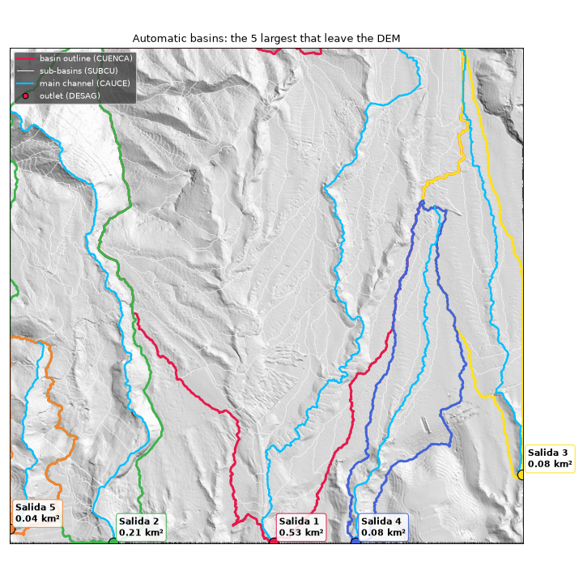

# Basins
<!-- id: hidrologia-cuencas -->
<!-- origen: c2e7b7f62743660eb92adec53a2b96a018f57f48 -->

[VirtuaLand Hydrology](/mdtopx/fichas-de-herramientas/ficha-de-herramientas-virtualand/virtualand-hidrologia.md)

This tool obtains the watershed of each outlet on the DEM: its outline, its main channel and, if requested, its sub-basins. It computes their parameters, the time of concentration and, if the rainfall data are given, the peak discharge with the rational method of the Spanish surface drainage standard 5.2-IC (Order FOM/298/2016). See [Hydrology](README.md) for how water runs over the DEM.

It tells where the water that passes through a point comes from (a culvert, an underpass, the mouth of a valley) and how much of it can arrive in a storm.

The outlets are chosen in the dialog, in one of these two ways:

* **Automatic**: the largest basins that leave the DEM, through its edge or into a hole with no data. It is the quickest way to see how an area drains without preparing anything. They are named «Salida 1», «Salida 2»… from the largest down.
* **From a file of points** (Shape, DXF, DWG, DGN, BIN, GeoPackage, KML or text): the entities with a single vertex (not the texts) and the points of the point clouds of up to 1000 points, in the coordinates of the file. The file does not need to be open. Each outlet is named after its code, followed by its number.

## Dialog

* **Outlets**
  * **Automatic: the N largest basins that leave the DEM**: the number of basins (5 by default).
  * **From a file of points**: the file with the outlets; the **...** button opens the explorer to look for it.
  * **Snap radius to the stream (0: auto)**: in metres, only for the outlets of a file. Each outlet is moved to the node with the largest accumulation within that distance, so that it falls on the stream even if it was picked beside it. With 0, the radius is two grid steps. The automatic ones are already on their stream.
* **Stream network**
  * **Minimum stream area (0: auto)**: in square metres, the area a node has to drain to be a stream.
  * **One sub-basin per stream segment**: each basin is split into the sub-basins that drain to each segment of its stream network.
* **Rational method (Spanish 5.2-IC)**
  * **Compute the peak discharge**: with the box checked, the discharge of each basin is computed with the three following data.
  * **Maximum daily rainfall Pd**: in millimetres, the one of the return period of the calculation.
  * **Torrentiality index I1/Id**: the one of the map of the standard.
  * **Runoff threshold P0**: in millimetres, already corrected (P0 = P0i · β).
* **HTML report**: with the box checked, the report is written to the file of the field beside it, which by default is the name of the DEM ending in «_cuencas.html», next to the DEM; the **...** button chooses another one. If the file exists, it is replaced. When the tool finishes, the report opens in the browser.

When **OK** is pressed nothing else is asked. If no outlet falls on the DEM, the information window says between which coordinates the points read are and between which ones the DEM is.

## Result

A new drawing, «Basins of» and the name of the DEM, with:

* **CUENCA**: the outline of each basin, as a closed polyline; the holes (areas without data inside the basin), as separate polylines.
* **SUBCU**: the outline of each sub-basin.
* **CAUCE**: the main channel, from its origin to the outlet.
* **DESAG**: the outlet, already snapped to the stream.

Each entity is linked to its row of the attribute table **CUENCAS**:

| Field | Contents |
|---|---|
| TIPO | CUENCA (basin) or SUBCUENCA (sub-basin) |
| NOMBRE | The name of the outlet |
| AREA_KM2 | Area, in km² |
| PERIMETRO | Perimeter of the outline, in m |
| KC | Gravelius compactness index: Kc = 0.28 · P / √A |
| COTA_MIN, COTA_MED, COTA_MAX | Minimum, mean and maximum elevation |
| PEND_MED | Mean slope of the nodes, in m/m |
| L_CAUCE, DESN_CAUCE, J_CAUCE | Length (m), drop (m) and slope (m/m) of the main channel |
| INT_HIPSO | Hypsometric integral: (mean − minimum) / (maximum − minimum) |
| TC_TEMEZ | Témez time of concentration, in hours |
| TC_KIRPICH | Kirpich time of concentration, in hours |
| INTENSIDAD | Rainfall intensity for the time of concentration, in mm/h |
| C_ESCORR | Runoff coefficient |
| CAUDAL | Peak discharge, in m³/s |
| ORDEN | For the sub-basins: the Strahler order of the segment that drains it |
| AVISO | Whether the basin is outside the scope of the rational method (see below) |

## How to read the result

* Each **CUENCA** outline encloses all the land whose water ends up leaving through its outlet: the rain that falls inside goes through that point, and the rain that falls outside does not. In the picture, the basin of «Salida 1» (0.53 km²) collects the central valley.
* The **SUBCU** split the basin into the parts that drain to each stream segment: they show which slope feeds each segment. With many small sub-basins, raise the **Minimum stream area**.
* The **CAUCE** is the flow path that takes longest to reach the outlet; its length and slope give the time of concentration.
* To see the figures of a basin, select its outline and look at its attributes (the table **CUENCAS**). The HTML report has the same, plus the hypsometric curve and the rational method step by step.
* The Gravelius index **KC** tells how round the basin is: 1 is a circle; the closer to 1, the more the floods gather at once.

When it ends, the information window gives the number of basins, where the report is and a reading guide like this one.

## Main channel and time of concentration

The main channel is, among the flow paths that start on the divide of the basin, the one that gives the largest time of concentration, as the standard requires. Its slope is its drop divided by its length.

* **Témez** (standard 5.2-IC): tc = 0.3 · L^0.76 · J^−0.19, with tc in hours and L in kilometres.
* **Kirpich**: tc = 0.0195 · L^0.77 · J^−0.385, with tc in minutes and L in metres; the table gives it in hours.

## Rational method

With A in km² and the Témez time of concentration (t, in hours):

* Area reduction factor: KA = 1 − log10(A) / 15 (1 if A < 1 km²).
* Mean daily intensity: Id = Pd · KA / 24.
* Intensity: I = Id · (I1/Id)^(3.5287 − 2.5287 · t^0.1).
* Runoff coefficient: with r = Pd · KA / P0, C = (r − 1) · (r + 23) / (r + 11)² if r > 1, and 0 otherwise.
* Uniformity coefficient: Kt = 1 + t^1.25 / (t^1.25 + 14).
* Peak discharge: Q = I · C · A · Kt / 3.6.

The AVISO field marks the basins where the standard does not allow this method; the discharge is given anyway, as a reference:

* **tc<0,25h**: with a time of concentration below 0.25 hours the Témez formula does not apply; the standard requires the method of the secondary basins.
* **A>=50km2**: the rational method is for basins of less than 50 km².

## Report

The HTML report (the file of the dialog, which opens in the browser when the tool finishes) has, for each basin, the summary, the table of parameters, the hypsometric curve, the rational method step by step (if requested), with its warnings, and the sub-basins.
