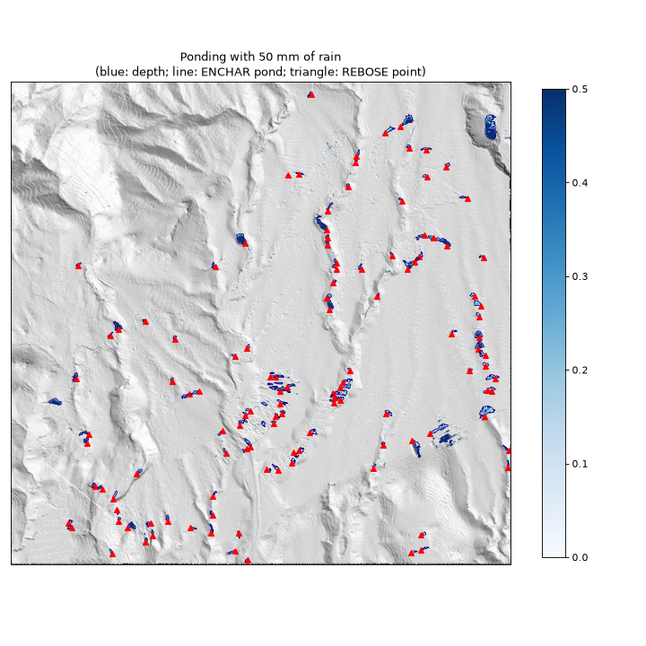

# Ponding
<!-- id: hidrologia-encharcamiento -->
<!-- origen: 4e3eb80bb896db6bfd582f9ace4c4f50a3a2b1ae -->

[VirtuaLand Hydrology](/mdtopx/fichas-de-herramientas/ficha-de-herramientas-virtualand/virtualand-hidrologia.md)

This tool obtains where the water of a rainfall stays in the depressions of the terrain, with the Fill-Spill-Merge algorithm (Barnes, Callaghan and Wickert, 2021):

1. The water that runs off at each node flows down, along the steepest descent, to the bottom of its depression. Here the DEM is not filled.
2. Each depression fills up to the elevation of the saddle it would spill over.
3. What it has left over goes over the saddle and down into the next depression, the steepest one from the saddle.
4. When two neighbouring depressions are full, they merge into a single pond, which keeps rising with the water of both.
5. The water that reaches the edge of the DEM or a no-data node leaves the model.

Flats (neighbouring nodes at the same elevation) count as a whole: the water that falls on a flat with an outlet, or that reaches a flat saddle, leaves through the steepest point of the whole flat.

Each pond is horizontal, with the volume of water it receives. It is a static calculation: it gives where the water ends up, not when it gets there.

## Dialog

* **Rainfall**
  * **Rainfall**: in millimetres, the same over the whole DEM.
  * **Runoff threshold P0 (0: all runs off)**: in millimetres. With P0, the water that runs off is C · P, with the runoff coefficient of the Spanish standard 5.2-IC: C = (P/P0 − 1) · (P/P0 + 23) / (P/P0 + 11)² if P > P0, and 0 otherwise. With 0 all the rainfall runs off.
* **Ponds in the drawing**: the ponds below these minimums are not in the drawing, although they are in the DEM of water depths and in the totals. A noisy DEM (unfiltered or with bridges) has many small depressions.
  * **Minimum area**: in square metres.
  * **Minimum depth**: in metres, the one of the deepest point of the pond.
* **DEM with the water depths**: also opens a DEM with the depth of each node with water.

## Result

* A new drawing, «Ponding of» and the name of the DEM, with:
  * **ENCHAR**: the outline of each pond.
  * **REBOSE**: for the full ponds, the saddle they spill over, as a point at its elevation.

  Each entity is linked to the row of its pond in the attribute table **ENCHARCAMIENTO**:

  | Field | Contents |
  |---|---|
  | LAMINA | Number of the pond, from largest to smallest volume |
  | COTA | Elevation of the water surface |
  | AREA | Area of the nodes with water, in m² |
  | VOLUMEN | Volume of water, in m³ |
  | PROF_MAX | Maximum depth, in m |
  | COTA_REBOS | Elevation of the saddle it would spill over |
  | REBOSA | SI (yes) if the pond is full and what it receives beyond that goes on over the saddle |

* If checked, a new DEM, «Ponding depths of» and the name of the DEM.
* In the information window, the number of ponds and the volume stored, the volume of runoff and the volume that leaves the model.

## How to read the result

* Each **ENCHAR** outline is a puddle or a pond: the water that stays in a depression of the land with that rainfall. Its table says up to which elevation the water reaches, how much there is and how deep it is.
* A **REBOSE** point is on the lowest rim of a full pond: the water that no longer fits goes on from there. If the pond is not full (REBOSA = NO), it would still grow with more rain.
* In the depth DEM, each node has the depth of the water; 0 where none stays.
* In the totals of the information window, the water stored in the ponds plus the water that leaves the DEM is all the runoff. In the example, with 50 mm about 4,700 m³ of 58,000 m³ stay; the rest leaves the model.
* A noisy DEM gives many small ponds that are not real: the minimum area and depth keep them out of the drawing.
