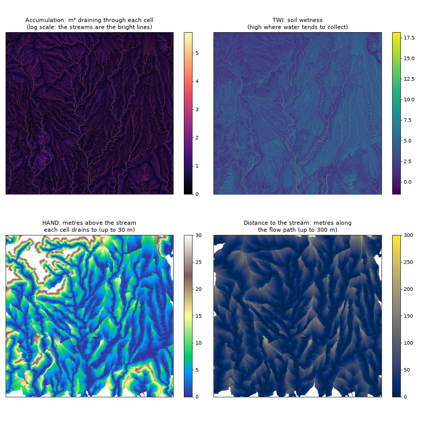

# Hydrology grids
<!-- id: hidrologia-rejillas -->
<!-- origen: 54a34683fa2e11fd04ce4fffbae65b452aedd4cc -->

[VirtuaLand Hydrology](/mdtopx/fichas-de-herramientas/ficha-de-herramientas-virtualand/virtualand-hidrologia.md)

This tool computes, at each node of the DEM, the hydrology grids checked in the dialog, and opens each one in a new DEM with the name of the grid and the name of the DEM. See [Hydrology](README.md) for how water runs over the DEM.

## Dialog

* **Grids (a new DEM for each one)**: the ones that are computed (at least one).
* **Minimum stream area (0: auto)**: in square metres, the area a node has to drain to be a stream. It only counts for the height and the distance to the stream.

## Grids

In the formulas, a is the specific catchment area (the accumulation divided by the cell width, in metres) and tan β the slope of the node.

| Grid | Contents |
|---|---|
| Accumulation | Area that drains through the node, in m² |
| Slope | tan β, in m/m, with the central differences of the elevations of its neighbours |
| Wetness index (TWI) | ln(a / tan β), with a minimum slope of 0.0001. The larger, the wetter |
| Stream power (SPI) | a · tan β: the erosive power of the running water |
| LS erosion factor | (a / 22.13)^0.6 · (sin β / 0.0896)^1.3 (Moore and Burch), the topographic factor of the USLE |
| Height above the stream (HAND) | Height of the node above the stream its water reaches, in metres, with the depressions filled |
| Distance to the stream | Length of the flow path to that stream, in metres |

The nodes whose water leaves the DEM without going through a stream have no data in the last two grids.

## How to read the result

Each grid opens as a DEM: what in a normal DEM is the elevation, here is the value of the index. It is easier to read with a colour palette by elevation and by checking the value of a point with the cursor.

* **Accumulation**: the high values draw the stream network; a node with 10,000 m² collects the water of one hectare.
* **TWI**: the high values are at the valley bottoms and on flats, where the soil tends to be wet or waterlogged; the low ones, on the ridges.
* **SPI** and **LS factor**: the high values mark where the water runs with more force, that is, where the risk of erosion is higher (gullies, slopes).
* **HAND**: 0 on the streams; the higher, the safer the node is from a flood. It is the basis of the [Flood zones](zonas-inundables.md).
* **Distance to the stream**: how far the water of each node travels until it reaches a stream.
