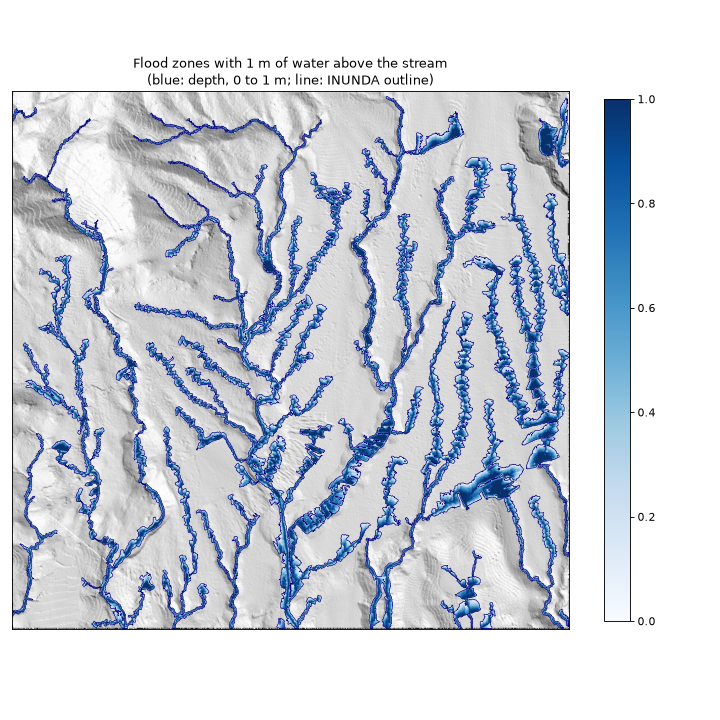

# Flood zones
<!-- id: hidrologia-zonas-inundables -->
<!-- origen: e14684013b7cdb5ce803d57edf7a441f627f111f -->

[VirtuaLand Hydrology](/mdtopx/fichas-de-herramientas/ficha-de-herramientas-virtualand/virtualand-hidrologia.md)

This tool obtains what is flooded when the streams carry a water height. It uses the height of each node above the stream its water reaches (HAND, see [Hydrology grids](rejillas-hidrologicas.md)): a node is flooded if that height does not exceed the water height of its stream, and its depth is the water height minus that height. See [Hydrology](README.md) for how water runs over the DEM.

It is a static calculation: it does not simulate how the water advances in time.

## Dialog

* **Water height in the stream**
  * **Constant height**: the same water height, in metres, in all the streams.
  * **From the specific discharge**: in m³/s per km² drained. Each segment of the network carries the specific discharge times the area it drains, and its water height comes from that discharge with the Manning synthetic rating curve over HAND (Zheng et al., 2018). For a water height h, the cells that drain to the segment give the wetted area A(h) = flooded volume / length of the segment and the wetted perimeter P(h) = flooded bed / length of the segment, and the discharge is Q(h) = A · (A / P)^(2/3) · S^(1/2) / n, with S the slope of the segment. The water height is the lowest one that carries the discharge.
  * **Manning's n**: the roughness coefficient (0.035 by default).
* **Minimum stream area (0: auto)**: in square metres, the area a node has to drain to be a stream.
* **DEM with the water depths**: also opens a DEM with the depth of each flooded node.

## Result

* A new drawing, «Flood zones of» and the name of the DEM, with the outline of each continuous flooded zone (code **INUNDA**), linked to its row of the attribute table **INUNDACION**: ZONA (number), AREA (m²), VOLUMEN (volume, m³) and CALADO_MAX (maximum depth, m).
* If checked, a new DEM, «Flood depths of» and the name of the DEM.
* In the information window, the number of zones and their area and volume.

## How to read the result

* Each **INUNDA** outline is a continuous patch of water: what would be under water if the streams rose by the given height.
* In the depth DEM, each node has the depth of the water: the full height at the stream and less towards the edges of the patch.
* The table **INUNDACION** gives the area, the volume and the maximum depth of each zone; the largest is ZONA 1.
* It is a quick approximation to see what is exposed. It does not replace a hydraulic study: it ignores bridges, obstacles and how the water advances.
