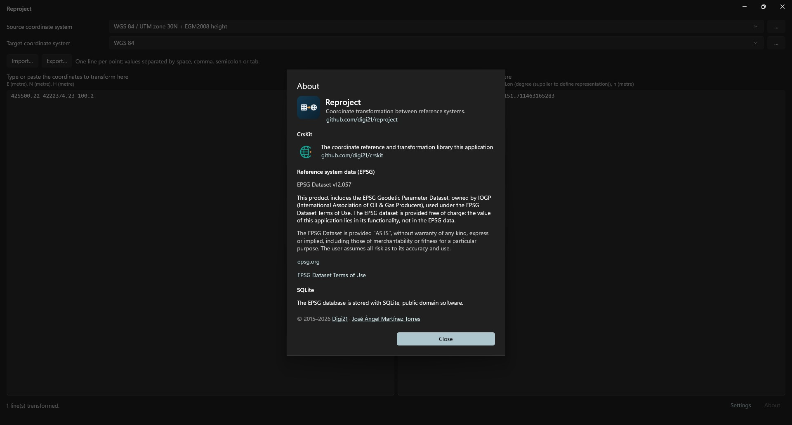

# Reproject
<!-- id: reproject -->
<!-- origen: c7fe2f97c89d499bb00488e388ba943aa87d1260 -->

**Reproject** is a Windows application that transforms coordinates between two coordinate reference systems (CRSs). It uses the complete EPSG catalog.

Reproject replaces the former Universal Coordinate Transformer.

## Features

* Select source and target systems by EPSG code or name, category (geographic 2D, geographic 3D, projected, vertical), as a compound system (horizontal + vertical), from WKT or from favorites.
* Instant transformation: results update line by line as coordinates are typed or pasted.
* Import coordinate lists from text files (`.txt`, `.csv`) and export results to `.txt` or `.csv`.
* Import and export coordinate system definitions as `.prj` or `.wkt`.
* Choose a transformation when EPSG offers several between two systems.
* Download geoid models required by some transformations.
* Control axis order (East-North or North-East) and view system details (area of use, datum, ellipsoid).
* Remember recent systems across sessions.
* Follow the Windows light/dark theme and language. Languages: English, Spanish, Galician, Basque, Catalan, Italian, French and German. Other Windows languages fall back to English.

## License and source code

Reproject is _open source_ under [Apache 2.0](https://github.com/digi21/reproject/blob/main/LICENSE).

* Repository: [https://github.com/digi21/reproject](https://github.com/digi21/reproject)
* Calculation engine: [CrsKit](https://github.com/digi21/crskit).

The application includes the _EPSG Geodetic Parameter Dataset_, owned by IOGP (International Association of Oil & Gas Producers), used under the [EPSG Dataset Terms of Use](https://epsg.org/terms-of-use.html). EPSG data are not covered by Apache 2.0. **About** shows the included EPSG catalog version.

## Contents

* [Installation](/reproject/instalacion.md)
* [Main window](/reproject/ventana-principal.md)
* [Coordinate system selection](/reproject/seleccion-del-sistema-de-coordenadas.md)
* [Transformations and geoid models](/reproject/transformaciones-y-modelos-de-geoide.md)
