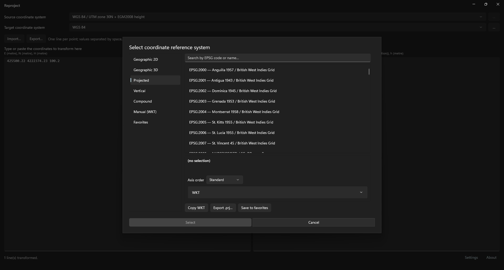
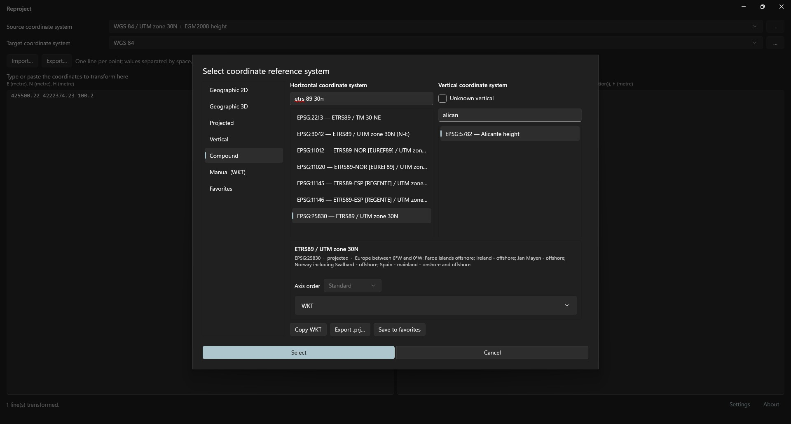

# Coordinate system selection
<!-- id: seleccion-del-sistema-de-coordenadas -->
<!-- origen: ec5789f3c7a5c5f13f1905d9600e0f93b84fa614 -->

**…** beside **Source coordinate system** or **Target coordinate system** opens **Select coordinate reference system**.

Three areas:

* Categories on the left.
* Selection for the active category on the right.
* Details and **Copy WKT**, **Export .prj…** and **Save to favorites** below.

Choose a system and click **Select**, or double-click it. **Select** is enabled only for a valid system. **Cancel** closes without changing the system.

Reopening restores the category and options used to select the current system.

## Categories

| Category | Contents |
|---|---|
| Geographic 2D | EPSG two-dimensional geographic systems. |
| Geographic 3D | EPSG three-dimensional geographic systems. |
| Projected | EPSG projected systems. |
| Vertical | EPSG vertical systems. |
| Compound | Horizontal and vertical system combination. |
| Manual (WKT) | System defined by WKT text. |
| Favorites | Systems saved with **Save to favorites**. |

## Find a system

Geographic 2D, Geographic 3D, Projected and Vertical list their systems in EPSG code order. **Search by EPSG code or name…** filters while typing:

* Every word must appear in the system name or code, in any order.
* Search ignores case, spaces and punctuation within each word.

Example: `WGS84 30N` finds `WGS 84 / UTM zone 30N`.

## Compound system

**Compound** has two lists:

* **Horizontal coordinate system**: projected, geographic 2D and geographic 3D systems.
* **Vertical coordinate system**: vertical systems.

Each has a search box with the same rules as above. The result is named `horizontal + vertical`.

Selecting **Unknown vertical** disables the vertical list and selects the horizontal system alone.

## System defined by WKT

**Manual (WKT)** uses a system outside EPSG:

1. Paste WKT into the text box or click **Import .prj…** to read `.prj`, `.wkt` or `.txt`.
2. Click **Validate**. Valid WKT shows the system name in details; invalid WKT shows the error.

Importing validates automatically, without **Validate**.

## Favorites

**Save to favorites** stores the selected system by name. **Favorites** shows the list alphabetically. **Remove** deletes the selected favorite.

## Details

Shows the selected system's:

* Name.
* EPSG code, type and area of use.
* Datum, prime meridian and ellipsoid.
* **Axis order**.
* WKT in the expandable **WKT** section.

## Axis order

Three options:

* **Standard**: EPSG axis order, shown in parentheses for the selected system.
* **East-North**.
* **North-East**.

Enabled only for geographic and projected systems in Geographic 2D, Geographic 3D and Projected. Changes the order in which main-window values are entered and read.

## Copy and export the definition

* **Copy WKT** copies the selected system's WKT to the clipboard.
* **Export .prj…** saves WKT to `.prj` (ESRI projection) or `.wkt`.
