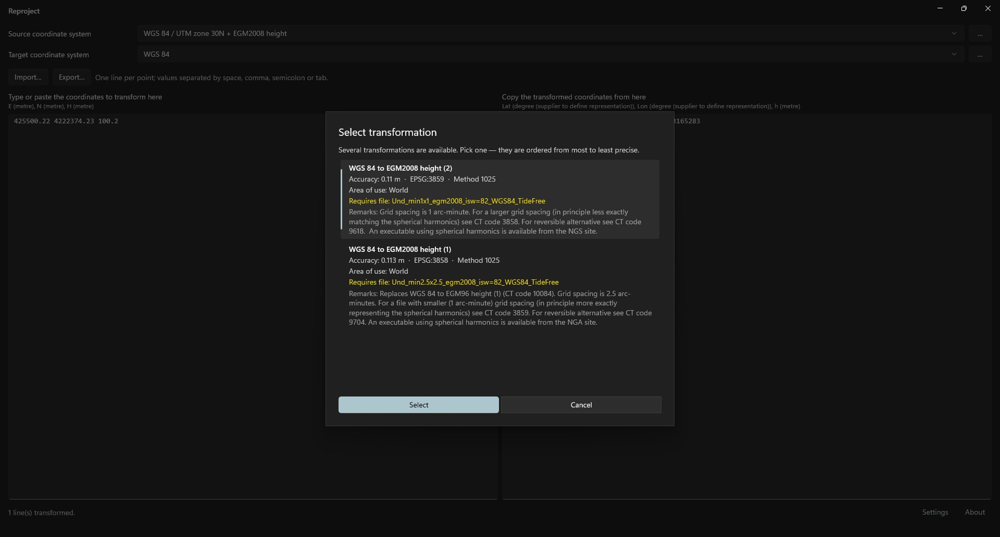

# Transformations and geoid models
<!-- id: transformaciones-y-modelos-de-geoide -->
<!-- origen: 81f8ce01a969c137f7a914af36230ff3fa5db002 -->

## Choose a transformation

EPSG may offer several transformations between systems. For example, WGS 84 to EGM2008 height has one per geoid grid resolution.

When several exist, selecting source or target opens **Select transformation**. Operations are ordered from most to least accurate, with unknown accuracy last. The first is selected.

Each shows:

* Name.
* Accuracy in meters (or “unknown”), EPSG code and method code.
* Area of use.
* Required grid file, if any.
* A download link when the application cannot download it directly.
* EPSG scope and remarks.

Click **Select** or double-click. **Cancel** creates no transformation and leaves output empty.

The choice is remembered for the system pair across restarts. Changing source or target forgets it and asks again.

Starting without a remembered transformation uses the most accurate one without prompting.

## Geoid models

Some transformations, such as those to heights above a geoid, require a grid file (geoid model). These files are not included in the package.

If a required file is absent from the geoid model directory:

* A known direct download URL opens **Download geoid model**, showing filename and size. **Download** saves it to the geoid model directory with progress. Once started, download cannot be cancelled. Completion creates the transformation.
* If only the publishing organization's website is known, **Geoid model required** shows filename and destination folder. **Open download page** opens the website; **Open folder** opens the geoid directory. Download and copy the file there, then select the system again.
* If no source is known, the main window error banner shows the error.

At startup, the application obtains geoid model sources from a public file in the CrsKit repository. Offline, it uses the last downloaded copy or its bundled list. Sources include global EGM2008 (NGA) and Spanish EGM08-REDNAP (IGN).

## Geoid model directory

**Settings** in the status bar opens **Settings**:

* **Geoid model (grid) directory**: folder searched for geoid files and used for downloads. Default: `Reproject\Grids` under local user data.
* **Browse…**: selects another folder.
* **Open folder in Explorer**: opens the folder, creating it first if necessary.

Click **Save** to save changes. The new directory takes effect after restarting.
