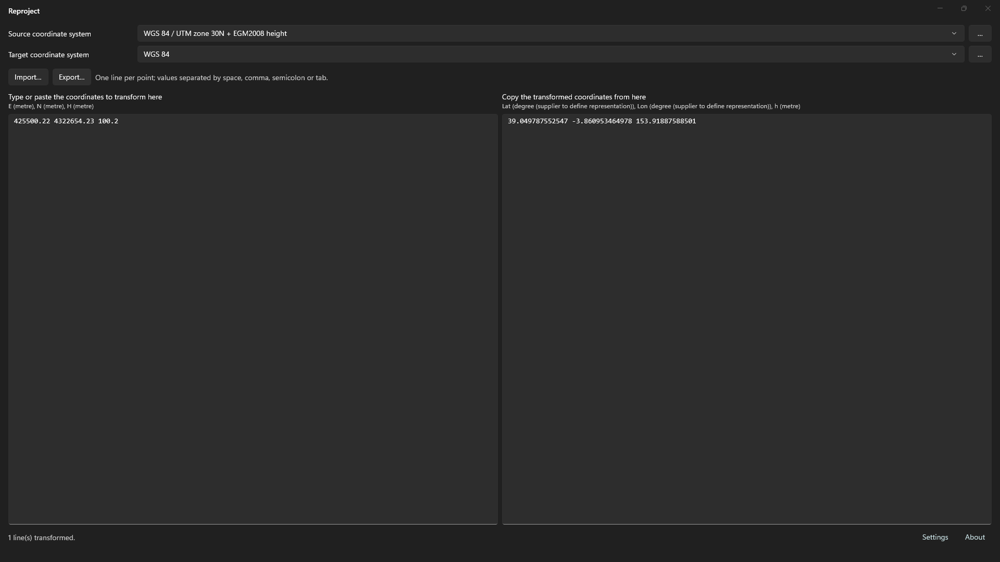

# Main window
<!-- id: ventana-principal -->
<!-- origen: 31d4ed10f37872cdccc4bf526724dbcddf50be34 -->



From top to bottom, the main window contains:

* **Source coordinate system**: drop-down and **…**.
* **Target coordinate system**: drop-down and **…**.
* **Import…** and **Export…**.
* Two text columns: input coordinates on the left and transformed coordinates on the right.
* Status bar with **Settings** and **About** links.
* Error banner, present only if a transformation cannot be created.

## Transform coordinates step by step

1. Click **…** beside **Source coordinate system** and select the input system. See [Coordinate system selection](/reproject/seleccion-del-sistema-de-coordenadas.md).
2. Click **…** beside **Target coordinate system** and choose the output system.
3. If EPSG offers several transformations, **Select transformation** appears. Choose one. See [Transformations and geoid models](/reproject/transformaciones-y-modelos-de-geoide.md).
4. Enter or paste coordinates into **Type or paste the coordinates to transform here**, or click **Import…** to read a file.
5. Copy from **Copy the transformed coordinates from here**, or click **Export…** to save results.

Transformation runs when systems are selected and whenever the left column changes. There is no transform button.

## Source and target drop-downs

Both share the 12 most recently selected systems, newest first. Selecting an entry is equivalent to choosing it with **…**.

Restarting restores source, target, recent systems and the chosen transformation for that pair.

## Input coordinate format

* One line per point.
* Separate values with space, comma, semicolon or tab.
* Decimal separator: period (`.`). A comma separates values and cannot be a decimal separator.
* Each line needs as many values as the source system has axes. Extra values are discarded.
* Value order follows source axes. Axes appear below each column title, comma-separated, with units in parentheses.
* Empty lines are preserved in output.

Example for a projected system with height:

```
435600.42 4532954.10 602.59
435601.23 4532961.10 600.42
```

Change geographic or projected axis orientation in system selection under **Axis order**.

## Output format

* One output line per input line, at the same position.
* Space-separated values with decimal periods and up to 12 decimal places.
* Value order follows target axes, shown below the right column title.

A failed line does not stop other lines. It shows an error instead:

| Message | Cause |
|---|---|
| `· error: expected N values` | Fewer values than source axes. |
| `· error: invalid numeric value` | A value is not numeric. |
| `· error: <message>` | Point transformation failed. The calculation engine supplies the message. |

## Import and export coordinates

* **Import…** opens `.txt`, `.csv` or any other extension and copies its contents to the left column. It must follow the input format above.
* **Export…** saves right-column contents as `.txt` or `.csv`. Proposed filename: `transformed-coordinates`.

## Status bar

Shows:

* At startup, the EPSG database path or its opening error.
* When creating a transformation, source and target names (`origen → destino`). For equivalent systems: “Identity transformation (source and target are equivalent).”
* When transforming, the transformed line count and error count, if any.

Links open:

* **Settings**: geoid model directory. See [Transformations and geoid models](/reproject/transformaciones-y-modelos-de-geoide.md).
* **About**: EPSG catalog version, Reproject and CrsKit repositories, and EPSG data terms.

## Error banner

If a transformation cannot be created, the full message appears in the lower banner: “Could not create the transformation: …”. The output column remains empty. Close the banner with its close button or by creating a valid transformation.
