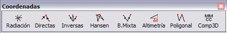
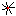
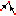
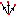
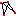
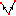
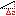
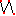
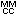

# Toolbar Coordinates
<!-- id: barra-de-herramientas-coordenadas -->
<!-- origen: 37402267064f99ac8ee40183bdef0986b00f42d7 -->

This toolbar contains the tools for calculating point coordinates by radial survey, intersection, resection, traversing and network adjustment. These tools are only available if a project is active, and they are:

*  [COGO](../herramientas/radiacion/README.md): Calculates, using coordinate geometry (COGO), the coordinates of new points from the coordinates of a station and the corresponding angle and distance observations.
*  [Intersec](../herramientas/intersecciones-directas/README.md): Calculates the coordinates of new points from the angle observations made from at least two points with known coordinates to a point with unknown coordinates.
*  [3-Resect](../herramientas/intersecciones-inversas/README.md): Calculates the coordinates of new points from the angle observations made to at least three points with known coordinates from a point with unknown coordinates.
*  [Hansen](../herramientas/intersecciones-de-hansen/README.md): Calculates the coordinates of two points from the observations made from those two points, with unknown coordinates, to two other points with known coordinates.
*  [2-Resect](../herramientas/biseccion-mixta/README.md): Calculates the coordinates of a point from the angle and distance observations made from that point to two other points with known coordinates.
*  [Altimetry](../herramientas/compensacion-de-altimetria/README.md): Calculates the height of a set of points from the observations made in an altimetric network, starting from at least one point with a known height.
*  [Traverse](../herramientas/poligonales/README.md): Calculates the coordinates of new points from the chain of angle and distance observations made between these points and at least one point with known coordinates.
*  [Comp3D](../herramientas/compensacion-por-minimos-cuadrados/README.md): Adjusts, by the least squares mathematical method, a network formed by a set of points between which angle and/or distance and/or altimetry observations have been made. To perform this calculation you need approximate coordinates of the non-fixed points of the network, for which you can use the other tools listed here.

