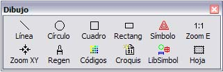
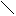
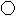
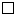
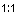
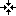
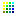
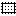

# Toolbar Drawing
<!-- id: barra-de-herramientas-dibujo -->
<!-- origen: 779e41a3ad52a877b3daf0cd954012307c71ed96 -->

This toolbar contains commands to insert entities, symbols and the sheet in the sketch file, adjust the view, and open the code lists and the symbol library. The following commands appear:

*  [Line](../dibujo/dibuja-entidad.md): Shows a dialog box that lets you record geographic entities (lines or arcs) as a join of the points of the files that are related to the sketch. This option is only enabled if a sketch file is active.
*  [Circle](../dibujo/insertar-circulo.md): Shows a dialog box that lets you record circles from several points stored in the files that are related to the sketch.
*  [Square](../dibujo/insertar-cuadrado.md): Shows a dialog box that lets you record squares from two points stored in the files that are related to the sketch.
*  [Rectang](../dibujo/insertar-rectangulo.md): Shows a dialog box that lets you record rectangles from three points stored in the files that are related to the sketch.
*  [Symbol](../dibujo/insertar-simbolo.md): Shows a dialog box that lets you record point symbols at points belonging to the files that are related to the sketch. This option is only enabled if a sketch file is active.
*  **ZoomE**: Adjusts the view to show the whole extent of the current drawing document. This option is only enabled if a sketch file is active.
*  **ZoomXY**: Centers the current window on a given point or given coordinates. This option is only enabled if a sketch file is active.
*  **Refresh**: Redraws the sketch in the current view. This option is only enabled if a sketch file is active.
*  [Codes](../opciones-de-visualizacion/preferencias-de-dibujo/listado-de-codigos-de-dibujo.md): Shows the list of drawing codes.
*  [Sketch](../opciones-de-visualizacion/preferencias-de-croquizacion/lista-de-codigos-de-croquizacion.md): Shows the list of automatic sketching codes.
*  [SimbLib](../opciones-de-visualizacion/preferencias-de-simbolizacion/libreria-de-simbolos.md): Shows the symbol library.
*  [Sheet](../dibujo/insertar-hoja.md): Inserts a sheet frame with crosses and coordinates at the corners.

