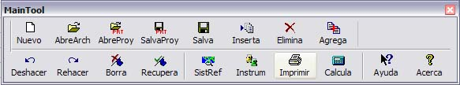
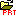
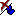
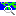
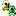

# Toolbar MainTool
<!-- id: barra-de-herramientas-maintool -->
<!-- origen: 86fa1e46191cf28bfb5003df9a5a851fcc3b8e3e -->

This toolbar contains the general commands of the program, such as opening, saving or printing files, or the help commands. The commands included are the following:

*  [New](../estructura-de-archivos/crear-un-fichero-nuevo.md): Creates a new document: a project, or a point, observation or sketch file.
*  **Open File**: Opens an existing point or observation file and adds it to the **Other files** folder.
*  **Open Project**: Opens an existing TopCal project.
*  **Save Project**: Saves the current project. This option is only enabled if the project has been modified.
*  **Save**: Saves the current document. This option is only enabled if the document has been modified.
*  **Insert**: Inserts a point or observation file into the current project.
*  **Delete**: Removes a point, observation or sketch file from the current project. It is only available if a project is active.
*  **Add**: Joins existing files to the current one. You can only add files of the same type as the current file; that is, only point files can be added to a point file, and only observation files to an observation file. The program opens Windows Explorer to select the files to add. In this dialog box you can select a single file or several files, using the Shift and Control keys.
*  **Undo**: Undoes the changes made in the current point, observation or sketch document. Up to the last ten operations performed are stored. This command is only enabled if changes were made in the document.
*  **Redo**: Lets the user redo a change that was previously undone. The changes only apply to point, observation or sketch files, and up to the last ten undone operations are stored. This command is only enabled if operations were undone.
*  **Delete**: Puts a deletion mark on the current record or on the selected records. If the option to display these records is enabled, they are shown in red in the spreadsheet. To enable this option, see the [Preferences](../opciones-de-visualizacion/preferencias.md) dialog box
*  **Retrieve**: Removes the deletion mark from the selected records.
*  [Reference systems](../otros-comandos/sistemas-de-referencia/listado-de-sistemas-de-referencia.md): Shows a list of the reference systems stored in the application, which are used when creating point files.
*  [Surveying instruments](../otros-comandos/instrumentos-topograficos/listado-de-instrumentos-topograficos.md): Shows a list of the surveying instruments stored in the application, which are used when creating observation files.
*  **Print**: Prints the current document.
*  **Calculator**: Shows the system calculator, for simple calculations.
*  **Help**: Shows the program help. If you click an element, it shows information about that element. If you click anywhere else on the screen, it shows general information about the program.
*  **About**: Shows information about the version of TopCal 21.

