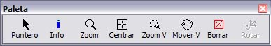

# Toolbar Palette
<!-- id: barra-de-herramientas-paleta -->
<!-- origen: 5fe5295633822f28f5f4448237b76430a636318e -->

This toolbar is intended for choosing tools to view or process the entities of the current sketch file. These tools are mutually exclusive, that is, only one can be chosen at a time, and choosing one changes the cursor type. The following commands appear:

*  **Pointer**: This option is chosen by default, and it has no specific function.
*  **Info**: Tool that gives information about the selected element. Click the left button to select the desired element and click it again to confirm the selection. Click the right button to deselect it or to search for another element at the same location.
*  **Zoom**: Select this option to change the display scale of the sketch. The left button increases the scale and the right button decreases it. You can select this tool by holding down the \[CTRL\] key. You can also zoom in or out of the current document view by pressing the \[PAGE DOWN\] and \[PAGE UP\] keys, respectively. A last way to run this command is with the center wheel of the mouse, if you have one.
*  **Center**: This option centers the view on a point.
*  **Zoom W**: This option adjusts the display to a desired window, selected with the left mouse button.
*  **Move W**: This option moves the display in real time: hold down the left button and move the mouse. You can select this tool by holding down the \[SPACEBAR\] key.
*  **Erase**: This option deletes elements of the drawing. You can select this tool by pressing the \[DELETE\] key.

Pressing the \[ESC\] key selects the *Pointer* command, which has no functionality.

