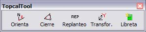
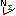

# Toolbar TopcalTool
<!-- id: barra-de-herramientas-topcaltool -->
<!-- origen: b4ce31b062a623de94298ba29edc755229b110c9 -->

This toolbar contains basic surveying calculation tools, which are:

*  [Orienta](../herramientas/calculo-de-desorientaciones/README.md): Calculates the orientation of a point based on observations to other points with known coordinates. This option is only enabled if a project is active.
*  [Closure](../herramientas/cierre-de-triangulos/README.md): Calculates the closures of triangles formed by a set of observations made between points. This option is only enabled if an observation file is active. You do not need point files or a project, so you only need to have an observation file selected.
*  [Stakeout](../herramientas/replanteo/README.md): Generates a file with the angle and distance observations that must be made to locate new points on the ground, in the stakeout operation. This option is only enabled if a project is active.
*  [Transfor.](../herramientas/transformacion/README.md): Transforms the coordinates of a point file to the coordinate system defined by the points of another file, using the points common to both systems. This option is only enabled if a project is active.
*  [Observa](../herramientas/generar-libreta-de-campo/README.md): Generates an observation file from the known coordinates of a set of points. This option is only enabled if a project is active.

