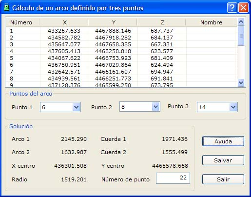

# Arc defined by three points
<!-- id: arco-definido-por-tres-puntos -->
<!-- origen: 6a31f44b099badfd63c3a06c36cfdde62056c92e -->

This tool is used to compute the arc defined by three points stored in the point file. To call up this tool, a point file must be active. The fields shown in the dialog box are the following:

* **Point list**: List of points of the current file.
* **Point 1**: Select the first point of the arc from the list.
* **Point 2**: Select the second point of the arc from the list.
* **Point 3**: Select the third point of the arc from the list.
* **Solution**: The two possible solutions are shown:
  * **Arc 1**: Arc length of the first solution, in meters
  * **Arc 2**: Arc length of the second solution, in meters
  * **Chord 1**: Chord length of the first solution, in meters
  * **Chord 2**: Chord length of the second solution, in meters
  * **X centre**: X coordinate of the arc center
  * **Y centre**: Y coordinate of the arc center
  * **Radius**: Radius of the arc
  * **Point number**: Number of the new point

Once the arc has been computed, you can click the **Save** button to save the center of that arc in the point file, with the point number indicated in the **Point number** field.

