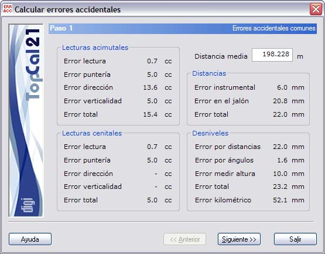

# Step 1: Common random errors
<!-- id: topcal21-calculo-de-errores-accidentales-paso-1-errores-accidentales-comunes -->
<!-- origen: 127a545ef36cd9b14e17c78ea79561c11fed51aa -->

This is the first step in computing random errors. This step is intended to show the common random errors that occur depending on the type of observation (horizontal angle, vertical angle, distance or height difference), based on the characteristics of the instrument and on a distance that the user can change.

A screen is shown where you must enter the distance used to compute the random errors that occur in the different types of observations. Initially, the **average distance** of all the observations of the current observation file is shown. The random errors shown are the following:

* **Horizontal angles**:
  * *Reading error*: Error produced when reading the value of the angle on the instrument. It depends on the angular reading resolution of the instrument.
  * *Sighting error*: Error made when sighting the prism. It depends on the magnification of the optics of the instrument.
  * *Direction error*: Error due to the lack of precision in marking the station and the target point. This precision is specified in the [properties of the observation document](../../opciones-de-visualizacion/propiedades-de-los-objetos/propiedades-del-archivo-de-visuales.md).
  * *Verticality error*: Error due to the lack of verticality of the instrument. It depends on the precision of the tubular level of the instrument.
  * *Total error*: Quadratic component of the previous errors.
* **Vertical angles**:
  * *Reading error*: Error produced when reading the value of the angle on the instrument. It depends on the angular reading resolution of the instrument.
  * *Sighting error*: Error made when sighting the prism. It depends on the magnification of the optics of the instrument.
  * *Direction error*: It does not affect vertical angle readings.
  * *Verticality error*: It does not affect vertical angle readings.
  * *Total error*: Quadratic component of the previous errors.
* **Distances**:
  * *EDM error*: Error produced when measuring the distance, which depends on the precision of the electronic distance meter (EDM).
  * *Rod height error*: Error produced by the tilt of the rod. It depends on the average reflector height.
  * *Total error*: Quadratic component of the previous errors.
* **Height differences**:
  * *Distance error*: Error produced by the precision of the distance measurement. It depends on the precision of the EDM.
  * *Angular error*: Error produced by the precision of the measurement of the vertical angles, shown above.
  * *Height error*: Error produced when measuring the height of the instrument and of the prism. It is estimated at 10 mm.
  * *Total error*: Quadratic component of the previous errors.
  * *Error per kilometer*: Total error expressed as an error per 1000 m of observation. In this way, you can compare the precision achieved by a trigonometric levelling with the precision of a geometric levelling, which is expressed in this way.

After entering the distance and reviewing the computed errors, click **Next** to continue to[Step 2: Errors by method and output data.](paso-2-errores-en-metodos-y-salida-de-datos.md)
