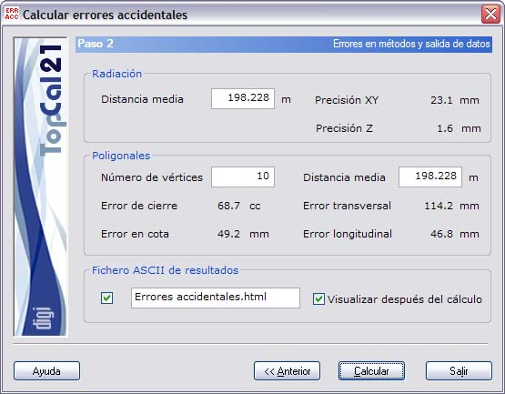

# Step 2: Errors by method and output data
<!-- id: topcal21-calculo-de-errores-accidentales-paso-2-errores-en-metodos-y-salida-de-datos -->
<!-- origen: 3de2a4bdfec881047d22628f8704be854c98a572 -->

This is the second and last step in computing random errors. This step is intended to analyze the errors that occur in the radial survey method and in the traversing method, depending on certain observation characteristics. In this way, you can choose a different instrument or different observation characteristics if the desired precisions are not achieved a priori.

The following fields are shown:

* **Survey**:
  * *Average distance*: You can enter a value for the average distance in meters. Initially, the average distance of all the observations of the current observation file is shown.
  * *XY accuracy*: Planimetric accuracy achieved at the target point.
  * *Z accuracy*: Altimetric accuracy achieved at the target point.
* **Traverses**:
  * *Number of stations*: Number of stations of the traverse. The greater the number of stations, the lower the precision.
  * *Average distance*: You can enter a value for the average distance in meters. Initially, the average distance of all the observations of the current observation file is shown.
  * *Closure error*: Maximum angular closure error of the traverse.
  * *Transversal error*: Planimetric error due to the angular precision.
  * *Longitudinal error*: Planimetric error due to the precision of the distances.
  * *Height error*: Altimetric error of the traverse.

In addition, you must specify the **ASCII output file** with the results of the computation. This file can be in html or ASCII format. If the extension of this file is HTM or html, it is treated as html format; otherwise it is treated as ASCII format. You can view this file (with the viewer specified in the [Preferences](../../opciones-de-visualizacion/preferencias.md) dialog of the [Edit menu](../../menus-de-la-aplicacion/menu-editar.md)) if you select the checkbox at the bottom named **Show after computation**.

If you do not want to create this file, clear the checkbox to the left of the name. The output file is created in the project directory, if there is one, or in the directory of the current observation file.

Once you have set up the output data, click the **Compute** button to finish the process, or click the **Back** button to return to the previous step, [Step 1: Common random errors](paso-1-errores-accidentales-comunes.md).
