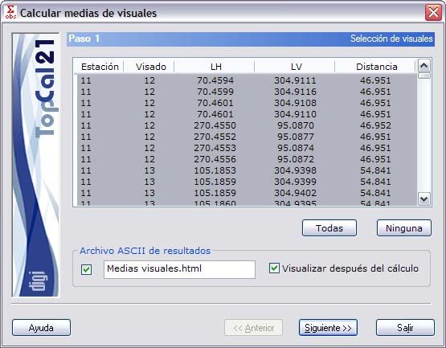

# Step 1: Observation selection
<!-- id: topcal21-calculo-de-medias-de-visuales-paso-1-seleccion-de-visuales -->
<!-- origen: da87e8325f505a42ccc14ea50e57e1868a0de30b -->

This is the first step in computing the averages of observations.

A screen is shown with all the observations of the file arranged in a list that shows the following fields:

* **Station**
* **Target**
* **Horizontal angle**
* **Vertical angle**
* **Geometric distance**

You can select multiple observations by holding down the *\[CTRL\]* key and clicking the desired observations with the left mouse button. If you click an observation that is already selected, the program deselects that observation.

You can also select ranges of observations by holding down the *\[SHIFT\]* key and clicking with the left mouse button the limit observations that define the range.

In the same way, you can use the **All** or **None** buttons to select all observations or deselect all observations, respectively.

In addition, you must specify the **ASCII output file** with the results of the computation. This file can be in html or ASCII format. If the extension of this file is HTM or html, it is treated as html format; otherwise it is treated as ASCII format. You can view this file (with the viewer specified in the [Preferences](../../opciones-de-visualizacion/preferencias.md) dialog of the [Edit menu](../../menus-de-la-aplicacion/menu-editar.md)) if you select the checkbox at the bottom named **Show after computation**.

If you do not want to create this file, clear the checkbox to the left of the name. The file is created in the project directory, if there is one, or in the directory of the current observation file.

Once you have entered these data, click the **Next** button to go to [Step 2: Standard deviations](paso-2-desviaciones-tipicas.md).
