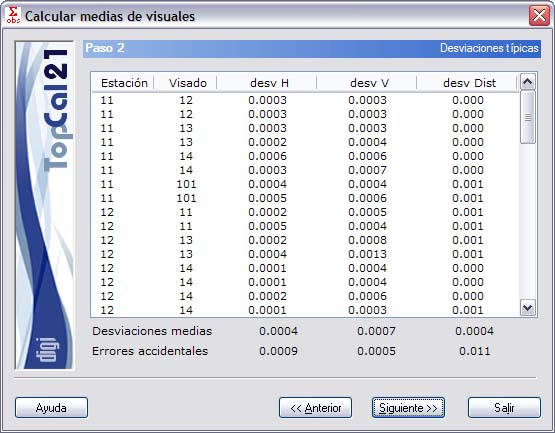

# Step 2: Standard deviations
<!-- id: topcal21-calculo-de-medias-de-visuales-paso-2-desviaciones-tipicas -->
<!-- origen: 7fe096e311f264865439b4390223f9fa9afcbdae -->

This is the second step in computing the averages of observations.

A screen is shown with the observations selected in the previous step. The list shows the averages and the standard deviations computed with those observations and contains the following fields:

* **Station point number**
* **Target point number**
* **Standard deviation of the mean horizontal angle**
* **Standard deviation of the mean vertical angle**
* **Standard deviation of the mean distance**

Below the list of standard deviations, the **mean** of the computed standard deviations and the corresponding **random errors** (horizontal angle, vertical angle and distance) are shown, so that you can assess whether the results obtained are suitable.

This step is for information only; you do not need to select anything, so you can click the **Next** button to go to [Step 3: Output data setup](paso-3-configurar-salida-de-datos.md), or click the **Back** button to return to [Step 1: Observation selection](paso-1-seleccion-de-visuales.md).
