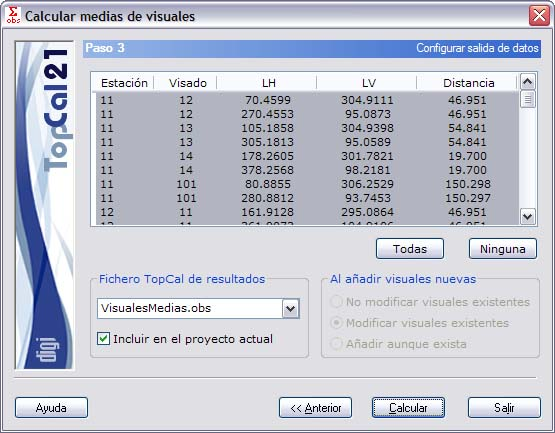

# Step 3: Output data setup
<!-- id: topcal21-calculo-de-medias-de-visuales-paso-3-configurar-salida-de-datos -->
<!-- origen: d5a60e20bb91c51557d8c328243a09f89d2246b4 -->

This is the third and last step in computing the averages of observations.

The following fields are shown:

* **List of average observations**: It shows the station number, target point number, horizontal angle, vertical angle and geometric distance.
* **TopCal output file**: Select the name of the TopCal file where the observations are stored. You can choose one of the existing files or generate a new one. If you want to generate a new file, you can choose whether or not to add the file to the current project. Select an output file different from the input file to prevent the repeated observations from being kept.
* **Adding new observations**: If the observation file is not new, you can choose whether or not to modify the observations with the same station and the same target that are in the chosen output file.

Once you have set up the output data, click the **Compute** button to finish the process, or click the **Back** button to return to the previous step, [Step 2: Standard deviations](paso-2-desviaciones-tipicas.md).
