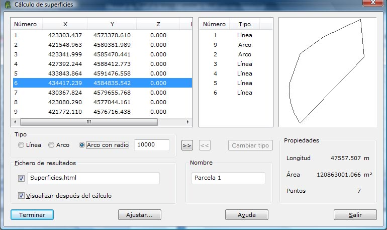

# Surface computation
<!-- id: calculo-de-superficies -->
<!-- origen: 30414c2d83764118f119e8d50f5c0c39bd9ed31d -->

With this tool you can compute the area and perimeter of a surface from the points that define it and, optionally, save the surface as a graphic in a sketch file. The surface can be defined with straight or curved stretches. The dialog box shows the following fields:

* **Point list**: List of the points of the current file.
* **List of points making up the surface**: To add points to this list, double-click the point in the list on the left with the left mouse button or click the **>>** button. To enter a curved stretch that goes from one point to another, select the **Arc** option in the **Type** field when you add the first point. Alternatively, you can select **Arc radius** and specify the radius in meters. In this case the program computes an interior point. If the radius is positive, the curve goes to the right; if it is negative, it goes to the left. The program automatically computes the radius of the arc that passes through that point and the next two. The type of a point belonging to a surface can also be changed by clicking the **Change type** button. To remove a point from this list, double-click it with the left mouse button or click the **&lt;&lt;** button.
* **Output file name**: This file is an ASCII file with the result of the computation and a list of the points that make up the surface. To generate it, activate the checkbox to the left of the file name. This file can be in **html** or **ASCII** format. If the extension of this file is HTM or html, it is treated as html format; otherwise it is treated as ASCII format. This file can be viewed (with the viewer specified in the [Preferences](../../opciones-de-visualizacion/preferencias.md) dialog box of the [Edit](../../menus-de-la-aplicacion/menu-editar.md) menu) if you activate the **Show after computation** checkbox.
* **Plot name**: Name of the plot with which the surface will appear in the output file.
* **[Adjust](ajustar-superficie.md)**: When you click this button, the program lets you modify the points that define a surface so that it fits an area value.

As points are entered, the program computes the area and the perimeter of the surface in real time.

Once the definition is complete, click the **Compute** button to [view the data](resultado-del-superficiado.md) or the **Exit** button to leave the dialog box.

