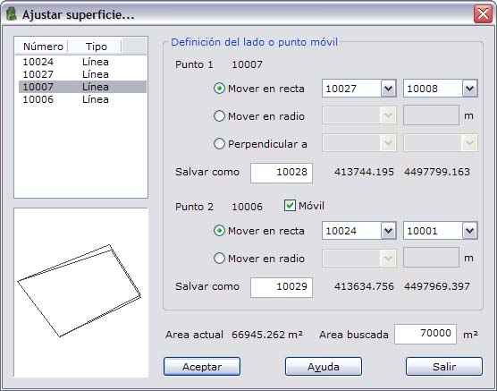

# Adjust area
<!-- id: ajustar-superficie -->
<!-- origen: ed51079053323e3cae0ceb1d6e58628f7d1c96d2 -->

With this tool the program computes the points that must define a surface so that its area matches a value supplied by the user. To do so, the user must choose which point or points are to be moved so that this condition is met.

The fields shown and the movement options available are as follows:

* **Point list**: Shows the points that define the current surface. In this list you must select the first point to be moved. The second point is chosen automatically and is the next one in this definition.
* **Graph**: Shows a graph with the current surface and the surface being computed with the new points.
* **Point 1 definition**: To adjust the area of the surface, the program needs to move at least one point. Here the number of the point selected in the point list is shown. The options to recompute the new point are also shown, as follows:
  * **Move in straight**: The newly computed point must move in the direction of the line defined by the indicated points.
  * **Move in radius**: The newly computed point must move at a fixed distance from the indicated point.
  * **Perpendicular to**: The new side (point 1 – point 2) must be perpendicular to the line defined by the indicated points.

  As the parameters are modified, the program computes the new coordinates and, if it reaches a solution, shows the coordinates to the right of the new point number. When you click **OK**, the program inserts the computed point with this number into the point file.
* **Point 2 definition**: The tool allows two points to be moved to adjust the area. To do so, activate the **Mobile** field. This field is activated automatically if the movement of the points is perpendicular to a side (option 3 in the Point 1 definition). The number shown corresponds to the point following the one selected in the point list. The options available to recompute the new point are as follows:
  * **Move in straight**: The newly computed point must move in the direction of the line defined by the indicated points.
  * **Move in radius**: The newly computed point must move at a fixed distance from the indicated point.

  As with point 1, as the parameters are modified, the program computes the new coordinates and, if it reaches a solution, shows the coordinates to the right of the new point number. When you click **OK**, the program inserts the computed point with this number into the point file.
* **Current area**: Shows the value of the area, in square meters, of the surface defined with the initial points.
* **Searched area**: Enter the value of the searched area in square meters.

To finish, click the **OK** button or leave the tool by clicking the **Exit** button. When you click **OK**, the program adds the newly computed points to the point file and modifies the points that define the surface to meet the imposed area condition.

