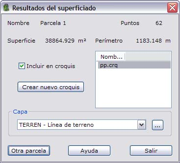

# Area computation results
<!-- id: resultado-del-superficiado -->
<!-- origen: 9a19005cc3473ac93a63274806a8ee56503b131a -->

Besides the results obtained, in this dialog box you can choose to save the surface as a graphic in a sketch file. To do so, the tool must have been called from a file that belongs to a project. In that case, the dialog box shows the sketch files of the current project. If the project does not contain any sketch file, you can create one by clicking the **Create new sketch** button. If you decide to include the surface in a sketch, select the layer in which the entity will be recorded.

Click **Another plot** to define another plot, or click **Exit** to close the tool.

