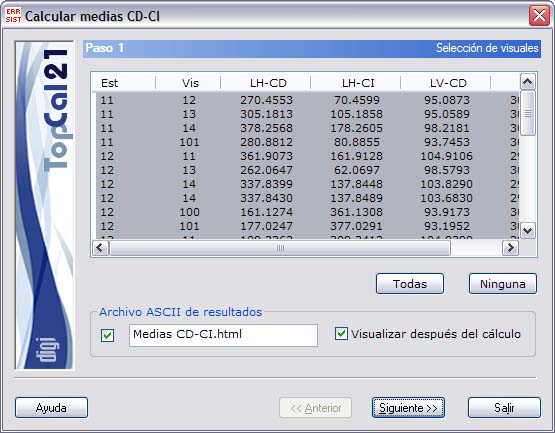

# Step 1: Observation selection
<!-- id: topcal21-calculo-medias-cd-ci-paso-1-seleccion-de-visuales -->
<!-- origen: 8e379423a2059fd1e2d6e5345f3a24bf9418f206 -->

This is the first step to compute the DC-IC averages and the systematic errors.

A screen is shown with the observations that have direct and inverse circle, so that the errors can be computed. Select the observations with which you want to compute the errors.

The list shown contains the following fields:

* **Station**
* **Target point**
* **Horizontal reading in direct circle**
* **Horizontal reading in inverse circle**
* **Vertical reading in direct circle**
* **Vertical reading in inverse circle**

You can select multiple observations by holding down the *\[CTRL\]* key and clicking the desired observations with the left mouse button. If you click an observation that is already selected, that observation is deselected.

You can also select observations arranged in ranges, by holding down the *\[SHIFT\]* key and clicking with the left mouse button the limit observations that define the range.

Likewise, you can use the **All** or **None** buttons to select or deselect all the observations.

In addition, you must specify the **ASCII file with the results** of the computation. This file can be in html or ASCII format. If the extension of this file is HTM or html, it is treated as html format; otherwise it is treated as ASCII format. This file can be viewed (with the viewer specified in the [Preferences](../../opciones-de-visualizacion/preferencias.md) dialog box of the [Edit menu](../../menus-de-la-aplicacion/menu-editar.md)) if you activate the checkbox at the bottom named **Show after computation**.

If you do not want to create this file, deactivate the checkbox to the left of the name. The file is created in the project directory, if there is one, or in the directory of the current observation file.

Once you have entered these data, click the **Next** button to go to [Step 2: Computation of systematic errors](paso-2-calculo-de-errores-sistematicos.md).
