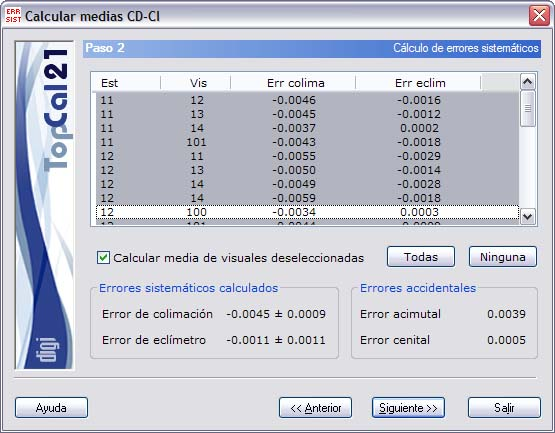

# Step 2: Computation of systematic errors
<!-- id: topcal21-calculo-medias-cd-ci-paso-2-calculo-de-errores-sistematicos -->
<!-- origen: f016910e8af9f466d7a4d885e5d6d4e64644cf88 -->

This is the second step to compute the DC-IC averages and systematic errors.

A screen is shown with the observations selected in the previous step, with which the errors shown in the list have been computed.

The list shown contains the following fields:

* **Station point number**
* **Target point number**
* **Collimation error**: Difference between the direct and the inverse horizontal reading.
* **Index error**: Difference between the direct and the inverse vertical reading.

You can select multiple observations by holding down the *\[CTRL\]* key and clicking the desired observations with the left mouse button. If you click an observation that is already selected, it is deselected.

You can also select observations arranged in ranges, by holding down the *\[SHIFT\]* key and clicking with the left mouse button the limit observations that define the range.

Likewise, you can use the **All** or **None** buttons to select or deselect all the observations.

According to the selected observations, the mean of the errors is computed simultaneously and shown in the **Computed systematic errors** field. Select or deselect observations to recompute that mean. The program also shows the horizontal (azimuthal) and vertical (zenithal) **accidental errors** as a reference to evaluate the selected observations.

If an observation is deselected, the program does not compute the mean between direct circle and inverse circle, unless you activate the **Compute average unselected observations** checkbox.

When you have selected the desired observations, you can click the **Next** button to go to [Step 3: Output data setup](paso-3-configurar-salida-de-datos.md) or return to [Step 1: Observation selection](paso-1-seleccion-de-visuales.md) by clicking the **Back** button.
