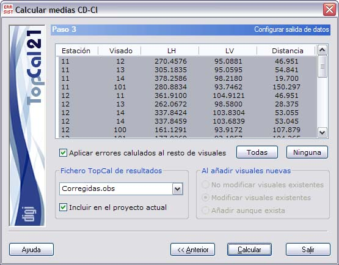

# Step 3: Output data setup
<!-- id: topcal21-calculo-medias-cd-ci-paso-3-configurar-salida-de-datos -->
<!-- origen: 2fb7f8897a9564cd5846ebb82200a5be9cb66b95 -->

This is the third and last step to compute the DC-IC averages and the systematic errors.

The following fields are shown:

* **List of computed errors with the corrected observations**: Shows the station number, target point number, horizontal reading, vertical reading and geometric distance.
* **Apply computed errors to other observations**: If you activate this field, the program applies the systematic errors computed in the previous step to the observations that did not have inverse circle.
* **TopCal output file**: You can select the name of the TopCal file where the observations will be stored. You can choose one of the existing files or generate a new file. If you want to generate a new file, you can choose whether or not to add the file to the current project. Select an output file different from the input file to avoid keeping the inverse-circle observations.
* **Adding new observations**: If the observation file is not new, you can choose whether or not to modify the observations with the same station and same target point that are in the chosen output file.

Once the output data are set up, you can finish the process by clicking the **Compute** button or return to the previous step, [Step 2: Computation of systematic errors](paso-2-calculo-de-errores-sistematicos.md), by clicking the **Back** button.
