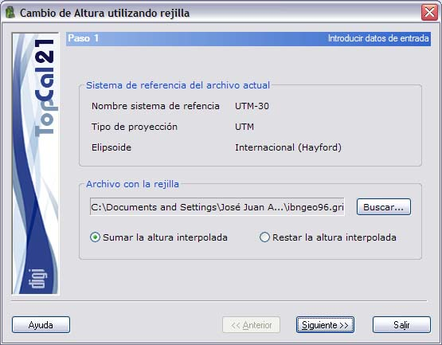

# Step 1: Enter input data
<!-- id: topcal21-cambio-de-altura-segun-rejilla-paso-1-introducir-datos-de-entrada -->
<!-- origen: 4af1adfccfeb160b7ac962d89cec417b1e4928ca -->

In the first step of the transformation of heights using a grid, the characteristics of the reference system of the current file, the file that contains the grid and the type of computation are shown.

Specify the file that contains the grid and how to compute with the interpolated value, that is, whether it must be **added** to or **subtracted** from the height value of each point.

Once you have entered these data, click the **Next** button to go to [Step 2: Point selection](paso-2-seleccion-de-puntos.md).
