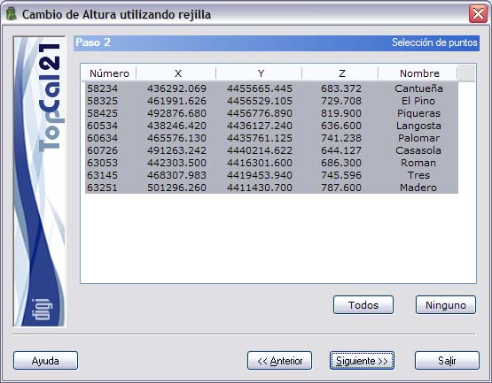

# Step 2: Point selection
<!-- id: topcal21-cambio-de-altura-segun-rejilla-paso-2-seleccion-de-puntos -->
<!-- origen: a43511aa40b799a6444738f2443ee616c9262801 -->

This is the second step of the transformation of heights using a grid. A screen is shown with the points with coordinates stored in the current file. Select the points you want to transform.

The list shown contains the following fields:

* **Point number**
* **Point coordinates**
* **Point name**

You can select multiple points by holding down the *\[CTRL\]* key and clicking the desired points with the left mouse button. If you click a point that is already selected, it is deselected.

You can also select points arranged in ranges, by holding down the *\[SHIFT\]* key and clicking with the left mouse button the limit points that define the range.

Likewise, you can use the **All** or **None** buttons to select or deselect all the points.

When you have selected the desired points, you can click the **Next** button to go to [Step 3: Output data setup](paso-3-configurar-salida-de-datos.md) or return to [Step 1: Enter input data](paso-1-introducir-datos-de-entrada.md) by clicking the **Back** button.
