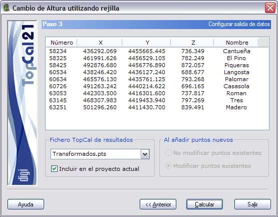

# Step 3: Output data setup
<!-- id: topcal21-cambio-de-altura-segun-rejilla-paso-3-configurar-salida-de-datos -->
<!-- origen: 9976bf8e70a450b65c0f861a84c8de803c535dab -->

This is the third and last step of the transformation of heights using a grid. Besides a list with the coordinates of the transformed points, the following fields are shown:

* **TopCal output file**: You can select the name of the TopCal file where the points will be stored. You can choose one of the existing files or generate a new file. If you want to generate a new file, you can choose whether or not to add the file to the current project.
* **Adding new points**: If the point file already exists, you can choose **Modify existing points** or **Not modify existing points** for the points in the output file whose number matches that of the computed points.

Once the output data are set up, you can finish the process by clicking the **Compute** button or return to the previous step, [Step 2: Point selection](paso-2-seleccion-de-puntos.md), by clicking the **Back** button.
