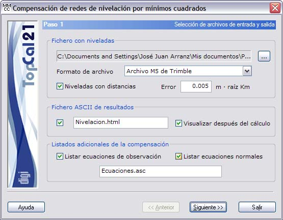

# Step 1: Input and output file selection
<!-- id: topcal21-compensacion-mmcc-de-red-de-nivelacion-paso-1-seleccion-de-archivos-de-entrada-y-salida -->
<!-- origen: 84c9d9852b3546be1f36ee91ae9f7726dd44e5c5 -->

This is the first step to compute the least squares compensation of a levelling network. The required data are as follows:

* **Levelling file**: In this field, enter the location of the file that contains the levelling runs made. The format of this file can be ASCII or the M5 format of Trimble digital levels. In the case of ASCII format, the file must consist of rows with the levelling runs, where the first column is point 1, the second column is point 2, the third column is the value of the height difference in meters and the fourth column is the distance between the points in meters (this column is optional). If the distance was measured in each levelling run, you can activate the **Levelling with distances** field to weight them in the computation; in that case, enter the **kilometric error** of the level, that is, its error per kilometer of levelling, in meters.
* **Output files**: Enter the name of the output file with the results of the computation. This file can be in **html** or **ASCII** format. If the extension of this file is HTM or html, it is treated as html format; otherwise it is treated as ASCII format. This file can be viewed (with the viewer specified in the [Preferences](../../opciones-de-visualizacion/preferencias.md) dialog box of the [Edit](../../menus-de-la-aplicacion/menu-editar.md) menu) if you activate the checkbox at the bottom named **Show after computation**. If you do not want to create this file, deactivate the checkbox to the left of the name. The file is created in the project directory.
* Finally, you can list, in ASCII format, the **equations** that the program has formed and the various matrices used to solve them, which are stored in the file specified for that purpose.

Once you have entered these data, click the **Next** button to go to [Step 2: Point selection](paso-2-seleccion-de-puntos.md).
