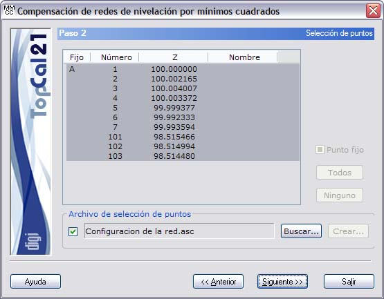

# Step 2: Point selection
<!-- id: topcal21-compensacion-mmcc-de-red-de-nivelacion-paso-2-seleccion-de-puntos -->
<!-- origen: 7c47fd01585e4e1b2a92d9535d0e466f79eff433 -->

This is the second step of the computation. A screen is shown with the points involved in the levelling stored in the file selected in *Step 1*.

The list shown contains the following fields:

* **Fixed checkbox**: This checkbox indicates whether or not the point is fixed. If it is fixed, the letter *A* appears. To assign this characteristic to points, select the desired points and activate or deactivate the **Fixed point in altimetry** checkbox located on the right side of the list.
* **Point number**
* **Point height**
* **Point name**

You can select multiple points by holding down the *CTRL* key and clicking the desired points with the left mouse button. If you click a point that is already selected, it is deselected.

You can also select points arranged in ranges, by holding down the *SHIFT* key and clicking with the left mouse button the limit points that define the range.

Likewise, you can use the **All** or **None** buttons to select or deselect all the points.

You can also load the network information from an ASCII network configuration file by activating the checkbox to the left of the file name and clicking the **Search** button to display Windows Explorer.

In addition, if this is the first time the network is configured, you can select the points manually and create the configuration file to use it on later occasions by clicking the **Create** button. The program displays Windows Explorer to save the file; it is recommended to save it in the project folder, together with the other project files.

To perform the compensation, only one fixed point is required, although there can be more.

When you have selected the desired points, you can click the **Next** button to go to [Step 3: Observation selection](paso-3-seleccion-de-visuales.md) or return to [Step 1: Input and output file selection](paso-1-seleccion-de-archivos-de-entrada-y-salida.md) by clicking the **Back** button.
