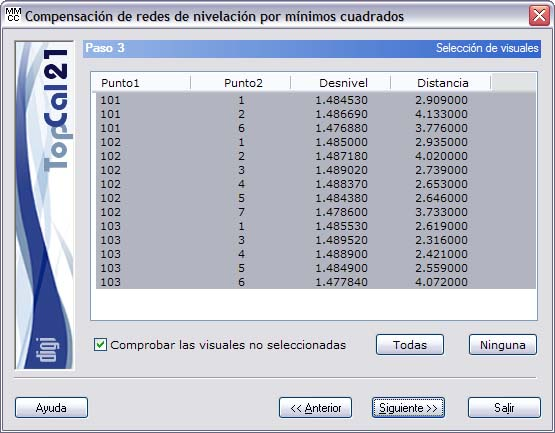

# Step 3: Observation selection
<!-- id: topcal21-compensacion-mmcc-de-red-de-nivelacion-paso-3-seleccion-de-visuales -->
<!-- origen: 2160d7c8e1464f28eeb141b40a74bfcbd67eab5a -->

The third step in the adjustment of the network is the selection of the observations that will make up the computation.

The program shows a list with the observations of the file selected in *Step 1* with their respective readings.

This way of presenting the data allows the user to deselect an observation that should not enter the computation, depending on the subsequent results.

In addition, the **Verify afterwards the unselected observations** checkbox is shown. When you activate it, the program computes the error of the observations that were not selected in this list using the adjusted coordinates, and writes the list with those errors in the output file, after the reliability test.

When you have selected the observations to use in the adjustment, you can click the **Next** button to go to [Step 4: Weights and residuals of the height differences](paso-4-pesos-y-residuos-de-los-desniveles.md) or return to [Step 2: Point selection](paso-2-seleccion-de-puntos.md) by clicking the **Back** button.
