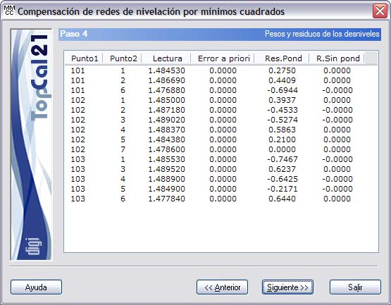

# Step 4: Weights and residuals of the height differences
<!-- id: topcal21-compensacion-mmcc-de-red-de-nivelacion-paso-4-pesos-y-residuos-de-los-desniveles -->
<!-- origen: c5d17ad3c7161253ef33d8c8df1b75c88c8034e8 -->

In the next step of the adjustment, the program analyzes a priori the height differences that will enter the computation, showing a list with the following data:

* **Point 1**
* **Point 2**
* **Reading**: Computed height differences in meters.
* **A priori error**: This error is the random error of this height difference and depends on the observation distance and the type of equipment. It is expressed in meters.
* **Weighted residual**: This dimensionless value is the result of dividing the not weighted residual by the a priori error of the observation.
* **Not weighted residual**: This value is the difference between the observed height difference (the observation itself) and the height difference computed with the approximate coordinates of the points. The difference can be due to observation errors or to errors in the approximate coordinates. It is expressed in meters.

By clicking the header of this list, you can sort it in ascending or descending order according to the clicked column.

You can click the **Next** button to go to [Step 5: Displacements and accuracies](paso-5-desplazamientos-y-precisiones.md) or return to [Step 3: Observation selection](paso-3-seleccion-de-visuales.md) by clicking the **Back** button.
