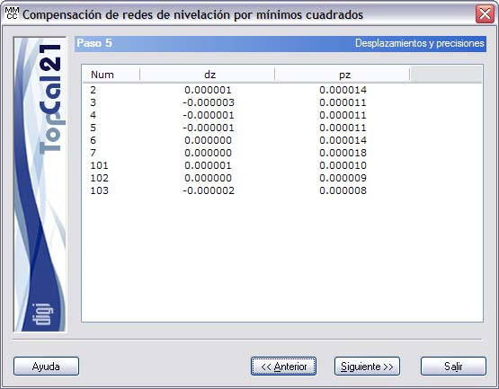

# Step 5: Displacements and vertical accuracies
<!-- id: topcal21-compensacion-mmcc-de-red-de-nivelacion-paso-5-desplazamientos-y-precisiones-altimetricas -->
<!-- origen: 23b1a6b6d0a635cb9ba7a5e0ef7e4c86813db54b -->

In this step, the program adjusts the vertical network and shows the result by presenting the displacements that the coordinates of the non-fixed points undergo, and their accuracies.

The displacements depend on the difference between the approximate heights and the heights obtained in the adjustment. However, the value of these approximate heights does not influence the value of the accuracies achieved. As mentioned at the beginning, it is not necessary to have computed approximate coordinates.

These results are shown in a list in which each line corresponds to a non-fixed point and whose fields are as follows:

* **Point number**
* **Z displacement**: This is the displacement that the approximate Z coordinate of the point undergoes after the adjustment, in meters. If no approximate heights are available, this value coincides with the height value of the point.
* **Z accuracy**: This is the accuracy achieved for the Z coordinate, in meters.

If the accuracy of a point could not be computed due to lack of redundancy, the character “?” appears in this field. By clicking the header of this list, you can sort it in ascending or descending order according to the clicked column.

This step is informative only; you do not need to select anything. Therefore, you can click the **Next** button to go to [Step 6: Results of the Baarda test](paso-6-resultados-del-test-de-baarda.md) or return to [Step 4: Weights and residuals of the height differences](paso-4-pesos-y-residuos-de-los-desniveles.md) by clicking the **Back** button.
