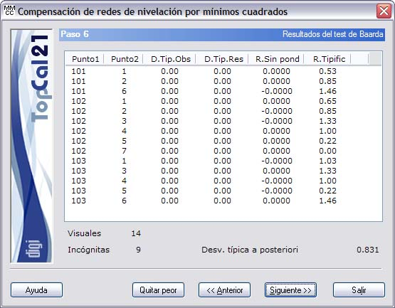

# Step 6: Results of the Baarda test
<!-- id: topcal21-compensacion-mmcc-de-red-de-nivelacion-paso-6-resultados-del-test-de-baarda -->
<!-- origen: 4335da055063a7ed6760ced389f515caba7e8027 -->

Once the adjustment has been done and the results presented, the next step is devoted to the Baarda statistical test. The program shows the standardized residuals of the observations that took part in the computation and the standard deviation of the adjustment.

This test detects possible gross errors in observations by means of a dimensionless value called standardized residual. If this value exceeds a threshold of 3.29, the observation can be said to be erroneous with a 99.9% probability.

In the process of eliminating erroneous observations, proceed one by one, always starting with the observation with the greatest standardized residual, because one observation can affect the others. You can deselect that observation manually, by going back to *Step 3*, or with the **Remove worst** button, which deselects it in that step.

The result of the statistical test is shown in a list with the following fields:

* **Point1**
* **Point2**
* **Standard deviation of the observation**, whose unit is the same as that of the observation
* **Standard deviation of the residual**, whose unit is the same as that of the observation
* **Not weighted residual**, computed with the newly computed coordinates and whose unit is the same as that of the observation.
* **Standardized residual**, whose value must be below the threshold of 3.29. If it is above, the # mark appears on the right. If the goodness of the observation could not be checked, the character “?” appears.

By clicking the header of this list, you can sort it in ascending or descending order according to the clicked column.

In addition, the **number of observations** used and the **number of unknowns** that the program has solved are shown.

Finally, the **a posteriori standard deviation** of the system is also shown; its value is dimensionless and is interpreted as follows:

* If it is less than 1, the accuracy achieved is greater than expected for the equipment used.
* If it is 1, the accuracy achieved is equal to that expected for this equipment.
* If it is greater than 1, the accuracy achieved is lower than expected for the said equipment.

This step is informative only; you do not need to select anything. Therefore, you can click the **Next** button to go to [Step 7: Output data setup](paso-7-configurar-salida-de-datos.md) or return to [Step 5: Displacements and accuracies](paso-5-desplazamientos-y-precisiones.md) by clicking the **Back** button.
