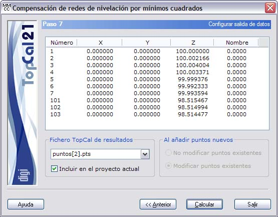

# Step 7: Output data setup
<!-- id: topcal21-compensacion-mmcc-de-red-de-nivelacion-paso-7-configurar-salida-de-datos -->
<!-- origen: eabcafd868ec4e4ea1c6394b0393b150b7ad6e11 -->

In this step a screen is shown with the final computed coordinates and the way to save those coordinates. The following fields are shown:

* **Final coordinates**: Shows a list with the new computed points, their coordinates and their orientation.
* **TopCal output file**: You can select the name of the TopCal file where the points will be stored. You can choose one of the existing files or generate a new file. If you want to generate a new file, you can choose whether or not to add the file to the current project.
* **Adding new points**: If the point file is not new, you can choose whether or not to modify the points with the same number that are in the chosen output file.

Once the output data are set up, you can finish the process by clicking the **Compute** button or return to [Step 6: Results of the Baarda test](paso-6-resultados-del-test-de-baarda.md) by clicking the **Back** button.
