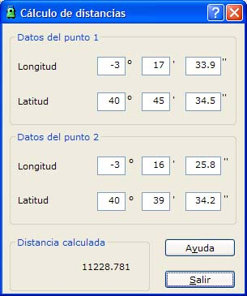

# Computation of geographic distances
<!-- id: calculo-de-distancias-geograficas -->
<!-- origen: f1b8637438b50498e5a5eab9b5ff2979342af1ab -->

This tool is used to compute the distance defined by the geographic coordinates of two points. A dialog box is shown that you must fill in with the geographic coordinates (sexagesimal degrees, minutes and seconds) of both points, and the program simultaneously shows the result, in meters.

