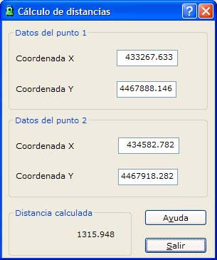

# Distance computation in UTM projection
<!-- id: calculo-de-distancias-en-proyeccion-utm -->
<!-- origen: c23ebc540101c99b98fa1fe2a17bc4aeb0597e4c -->

This tool is used to compute the distance defined by two points in UTM projection. A dialog box is shown that you must fill in with the UTM coordinates in meters of both points, and the program simultaneously shows the result, also in meters.

